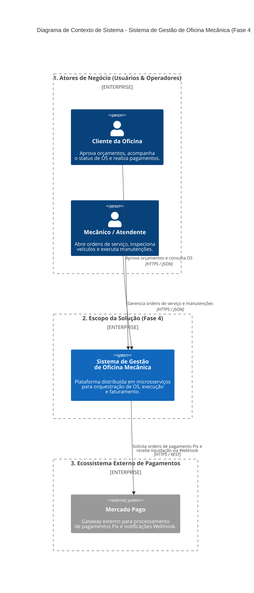
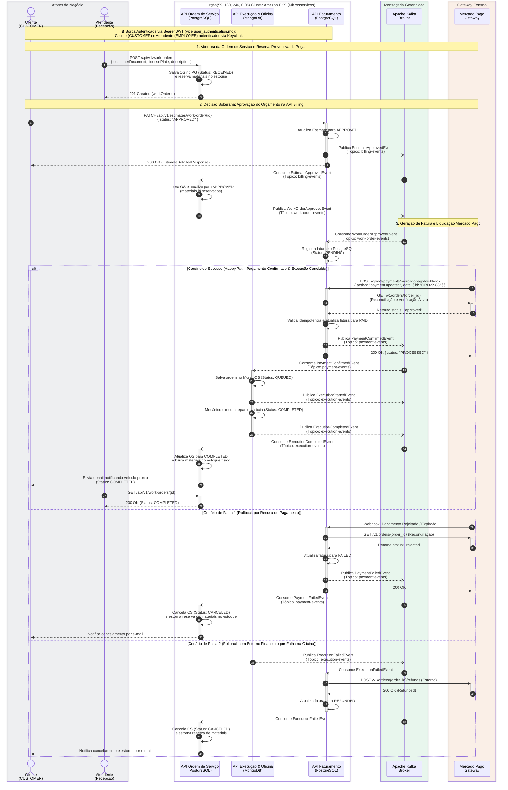

# Bateria de Testes End-to-End (BDD) e Testes de Carga/Estresse (`15soat-phase4-e2e`)

Repositório centralizado de testes automatizados para a Fase 4 do Tech Challenge da pós-graduação em Software Architecture (SOAT) da FIAP, orquestrando testes comportamentais de ponta a ponta (BDD via Cucumber) entre os três microsserviços, Lambdas Serverless e testes de estresse de performance dedicados por fluxo funcional (com 100% de paridade em relação à Fase 3).

## Tecnologias
- **Java 25 LTS**
- **Cucumber 7.x** (Cenários BDD Gherkin em português, estruturados segundo a especificação de negócio)
- **RestAssured 5.x** (Validação de contratos de API REST e asserções HTTP)
- **k6** (1 script de teste de carga e estresse dedicado para cada fluxo funcional compartilhando o mesmo nome base)
- **Diagramas de Sequência em Mermaid** (Acompanhando cada arquivo `.feature` em formato markdown responsivo)

---

## 🏛️ Arquitetura Macro do Sistema (C4 Model)

O sistema de gestão de oficina mecânica da **Fase 4** é construído sob uma **Arquitetura Orientada a Eventos (Event-Driven Architecture - EDA)**, com microsserviços desacoplados, padrão *Database-per-Service* com persistência poliglota, orquestração de transações distribuídas via *Choreographed Saga* no Apache Kafka e infraestrutura automatizada no Amazon EKS.

A arquitetura macro está detalhada a seguir segundo os níveis canônicos do **C4 Model** (Simon Brown):

### 1. Nível 1: Diagrama de Contexto de Sistema (System Context)

Apresenta os usuários do sistema, os limites da solução de oficina mecânica e a integração com sistemas externos de pagamento:



---

### 2. Nível 2: Diagrama de Contêineres (Containers)

Detalhamento de todos os contêineres de aplicação, mensageria distribuída, bancos de dados relacionais e NoSQL, proxies de borda e funções serverless:

```mermaid
C4Container
    title Diagrama de Contêineres - Sistema de Gestão de Oficina Mecânica (Fase 4)
  
    Enterprise_Boundary(b_actors, "1. Atores & Clientes") {
        Person(customer, "Cliente da Oficina", "Aprova orçamentos e realiza<br/>pagamentos Pix.")
        Person(mechanic, "Mecânico / Atendente", "Abre ordens de serviço, inspeciona<br/>veículos e registra manutenções.")
    }

    Container_Boundary(b_edge, "2. Camada de Borda & Serverless (iac-lambda)") {
        Container(apigw, "AWS HTTP API Gateway v2", "AWS API Gateway", "Ponto de entrada público para rotas<br/>serverless e recepção de webhooks.")
        Container(webhook, "Lambda Mercado Pago Webhook", "Node.js 20 / Lambda", "Recepção e validação de callbacks<br/>de notificação de pagamento Pix.")
        Container(nlb, "AWS Network Load Balancer (NLB)", "AWS NLB", "Entrada de rede de alta performance (L4)<br/>para o cluster EKS.")
    }

    Container_Boundary(eksCluster, "3. Plataforma Kubernetes Amazon EKS 1.30 (iac-k8s)") {
        Container(kong, "Kong Ingress Controller", "Kong Ingress / Proxy NLB", "API Gateway Ingress para roteamento<br/>HTTP L7 aos microsserviços.")

        Container(api_wo, "api-work-order", "Spring Boot 4 / Java 25", "Gestão de clientes, veículos,<br/>triagem e ciclo de vida de OS.")
        Container(api_billing, "api-billing", "Spring Boot 4 / Java 25", "Faturamento, emissão de faturas,<br/>integração Pix e reconciliação.")
        Container(api_exec, "api-exec", "Spring Boot 4 / Java 25", "Fila de oficina, inspeções,<br/>alocação de peças e execução.")

        ContainerQueue(kafka, "Apache Kafka Cluster", "Strimzi KRaft (3 brokers)", "Cluster de mensageria para<br/>coreografia assíncrona da saga.")
        ContainerDb(mongo, "MongoDB StatefulSet (exec_db)", "MongoDB 7.0 Community", "Armazenamento NoSQL de documentos<br/>de inspeção e ordens de execução.")
    }

    Container_Boundary(b_data, "4. Bancos Relacionais AWS RDS & Governança de Segredos (iac-db)") {
        ContainerDb(rds_wo, "RDS PostgreSQL (work_order_db)", "PostgreSQL 16.10", "Banco relacional isolado (Database-per-Service)<br/>para api-work-order.")
        ContainerDb(rds_billing, "RDS PostgreSQL (billing_db)", "PostgreSQL 16.10", "Banco relacional isolado (Database-per-Service)<br/>para api-billing.")
        Container(secrets, "AWS Secrets Manager", "AWS KMS / Secrets", "Gestão e rotação centralizada de<br/>credenciais e connection strings.")
    }

    Enterprise_Boundary(b_external, "5. Provedor Externo de Pagamentos") {
        System_Ext(mercadopago, "Mercado Pago", "Gateway externo de pagamentos Pix<br/>e envio de notificações via Webhook.")
    }

    Rel_Down(customer, nlb, "Consulta OS e aprova orçamentos", "HTTPS / JSON")
    Rel_Down(mechanic, nlb, "Gerencia ordens de serviço<br/>e manutenções", "HTTPS / JSON")

    Rel_Right(apigw, webhook, "Roteia payloads de<br/>notificação Pix", "AWS Lambda Invoke")
    Rel_Right(webhook, nlb, "Encaminha notificação<br/>confirmada", "HTTPS / JSON")

    Rel_Down(nlb, kong, "Encaminha tráfego balanceado L4/L7", "TCP / 80/443")
    Rel_Down(kong, api_wo, "Roteia /api/v1/work-orders", "HTTP / REST")
    Rel_Down(kong, api_billing, "Roteia /api/v1/invoices", "HTTP / REST")
    Rel_Down(kong, api_exec, "Roteia /api/v1/executions", "HTTP / REST")

    Rel(api_wo, kafka, "work-order-events", "Kafka Protocol")
    Rel(api_billing, kafka, "payment-events", "Kafka Protocol")
    Rel(api_exec, kafka, "execution-events", "Kafka Protocol")

    Rel_Down(api_wo, rds_wo, "Persiste ordens de serviço<br/>e veículos", "JDBC / HikariCP")
    Rel_Down(api_billing, rds_billing, "Persiste faturas e status<br/>de pagamento", "JDBC / HikariCP")
    Rel(api_exec, mongo, "Persiste histórico de execuções", "mongodb://")

    Rel_Right(rds_wo, secrets, "Credenciais gerenciadas", "AWS KMS")
    Rel_Right(rds_billing, secrets, "Credenciais gerenciadas", "AWS KMS")
    Rel(mongo, secrets, "Credenciais gerenciadas", "AWS KMS")

    Rel_Down(api_billing, mercadopago, "Gera ordem de pagamento<br/>e QR Code Pix", "HTTPS / REST")
    Rel_Up(mercadopago, apigw, "Dispara notificações<br/>de liquidação (Webhook)", "HTTPS / Webhook")

    UpdateLayoutConfig($c4ShapeInRow="4", $c4BoundaryInRow="1")
```



---

### 3. Visão Dinâmica: Coreografia da Saga Distribuída (Choreographed Saga)

Ilustra o comportamento temporal e as trocas assíncronas de mensagens via Apache Kafka entre os microsserviços durante o ciclo de vida da Ordem de Serviço, em conformidade com a ADR-004 e especificado em [`choreographed_saga.md`](src/test/resources/features/saga/choreographed_saga.md):



---

## Funcionalidades, Diagramas & Testes de Carga (1:1 por Fluxo)

### Matriz Geral de Rastreabilidade e Cobertura (Requisitos Fase 4)

A tabela abaixo consolida a rastreabilidade ponta a ponta entre as especificações de negócio em BDD (Gherkin), a modelagem formal de interação em diagramas de sequência, os scripts de teste de carga e estresse (k6), os microsserviços proprietários e a estratégia de persistência poliglota adotada (Database-per-Service):

| Domínio / Bounded Context | Especificação BDD (`.feature`) | Diagrama de Sequência (`.md`) | Teste de Carga k6 (`.js`) | Microsserviços Envolvidos | Persistência |
| :--- | :--- | :--- | :--- | :--- | :--- |
| **Clientes e Veículos** | [`customer_vehicle_management.feature`](src/test/resources/features/work-order/customer_vehicle_management.feature) | [`customer_vehicle_management.md`](src/test/resources/features/work-order/customer_vehicle_management.md) | [`customer_vehicle_management.js`](src/test/resources/features/work-order/customer_vehicle_management.js) | `api-work-order` | PostgreSQL (SQL) |
| **Catálogo de Serviços** | [`service_catalog_management.feature`](src/test/resources/features/work-order/service_catalog_management.feature) | [`service_catalog_management.md`](src/test/resources/features/work-order/service_catalog_management.md) | [`service_catalog_management.js`](src/test/resources/features/work-order/service_catalog_management.js) | `api-work-order` | PostgreSQL (SQL) |
| **Materiais e Peças** | [`material_management.feature`](src/test/resources/features/work-order/material_management.feature) | [`material_management.md`](src/test/resources/features/work-order/material_management.md) | [`material_management.js`](src/test/resources/features/work-order/material_management.js) | `api-work-order` | PostgreSQL (SQL) |
| **Ciclo de Vida da OS (7 Etapas)** | [`work_order_lifecycle.feature`](src/test/resources/features/work-order/work_order_lifecycle.feature) | [`work_order_lifecycle.md`](src/test/resources/features/work-order/work_order_lifecycle.md) | [`work_order_lifecycle.js`](src/test/resources/features/work-order/work_order_lifecycle.js) | `api-work-order` | PostgreSQL (SQL) |
| **Faturamento e Checkout Pix** | [`invoice_generation.feature`](src/test/resources/features/billing/invoice_generation.feature) | [`invoice_generation.md`](src/test/resources/features/billing/invoice_generation.md) | [`invoice_generation.js`](src/test/resources/features/billing/invoice_generation.js) | `api-billing` | PostgreSQL (SQL) |
| **Processamento de Webhook & Liquidação** | [`payment_webhook_processing.feature`](src/test/resources/features/billing/payment_webhook_processing.feature) | [`payment_webhook_processing.md`](src/test/resources/features/billing/payment_webhook_processing.md) | [`payment_webhook_processing.js`](src/test/resources/features/billing/payment_webhook_processing.js) | `api-billing`, `lambda-webhook` | PostgreSQL (SQL) |
| **Materiais & Checklist Técnico** | [`materials_and_checklist.feature`](src/test/resources/features/exec/materials_and_checklist.feature) | [`materials_and_checklist.md`](src/test/resources/features/exec/materials_and_checklist.md) | [`materials_and_checklist.js`](src/test/resources/features/exec/materials_and_checklist.js) | `api-exec` | MongoDB (NoSQL) |
| **Fila de Execução & Reparo** | [`execution_queue_and_repair.feature`](src/test/resources/features/exec/execution_queue_and_repair.feature) | [`execution_queue_and_repair.md`](src/test/resources/features/exec/execution_queue_and_repair.md) | [`execution_queue_and_repair.js`](src/test/resources/features/exec/execution_queue_and_repair.js) | `api-exec` | MongoDB (NoSQL) |
| **Saga Coreografada & Rollback** | [`choreographed_saga.feature`](src/test/resources/features/saga/choreographed_saga.feature) | [`choreographed_saga.md`](src/test/resources/features/saga/choreographed_saga.md) | [`choreographed_saga.js`](src/test/resources/features/saga/choreographed_saga.js) | `api-work-order`, `api-billing`, `api-exec`, `Apache Kafka` | Poliglota (PostgreSQL + MongoDB) |
| **Autenticação OIDC & Emissão JWT** | [`user_authentication.feature`](src/test/resources/features/auth-lambda/user_authentication.feature) | [`user_authentication.md`](src/test/resources/features/auth-lambda/user_authentication.md) | *N/A (Serverless / IAM)* | `Keycloak`, `lambda-auth` | PostgreSQL (Keycloak DB) |
| **Gestão & Provisionamento de Identidades** | [`user_identity_management.feature`](src/test/resources/features/auth-lambda/user_identity_management.feature) | [`user_identity_management.md`](src/test/resources/features/auth-lambda/user_identity_management.md) | *N/A (Serverless / IAM)* | `Keycloak`, `api-work-order`, `lambda-auth` | Poliglota (Keycloak DB + PostgreSQL) |

---

### 1. Microsserviço de Ordens de Serviço (`features/work-order/`)
- 📊 **Modelo de Dados & MER**: [`MODEL.md`](../15soat-phase4-api-work-order/MODEL.md) *(PostgreSQL - Clientes, Veículos, OS, Itens com Snapshot e Histórico)*
- **Gestão de Clientes e Veículos**:
  - Especificação BDD: [`customer_vehicle_management.feature`](src/test/resources/features/work-order/customer_vehicle_management.feature)
  - Diagrama de Sequência: [`customer_vehicle_management.md`](src/test/resources/features/work-order/customer_vehicle_management.md)
  - Teste de Carga (k6): [`customer_vehicle_management.js`](src/test/resources/features/work-order/customer_vehicle_management.js)
- **Gestão do Catálogo de Serviços**:
  - Especificação BDD: [`service_catalog_management.feature`](src/test/resources/features/work-order/service_catalog_management.feature)
  - Diagrama de Sequência: [`service_catalog_management.md`](src/test/resources/features/work-order/service_catalog_management.md)
  - Teste de Carga (k6): [`service_catalog_management.js`](src/test/resources/features/work-order/service_catalog_management.js)
- **Gestão de Materiais e Peças**:
  - Especificação BDD: [`material_management.feature`](src/test/resources/features/work-order/material_management.feature)
  - Diagrama de Sequência: [`material_management.md`](src/test/resources/features/work-order/material_management.md)
  - Teste de Carga (k6): [`material_management.js`](src/test/resources/features/work-order/material_management.js)
- **Ciclo de Vida Completo da Ordem de Serviço (7 Etapas)**:
  - Especificação BDD: [`work_order_lifecycle.feature`](src/test/resources/features/work-order/work_order_lifecycle.feature)
  - Diagrama de Sequência: [`work_order_lifecycle.md`](src/test/resources/features/work-order/work_order_lifecycle.md)
  - Teste de Carga (k6): [`work_order_lifecycle.js`](src/test/resources/features/work-order/work_order_lifecycle.js)

### 2. Microsserviço de Faturamento e Pagamentos (`features/billing/`)
- 📊 **Modelo de Dados & MER**: [`MODEL.md`](../15soat-phase4-api-billing/MODEL.md) *(PostgreSQL - Faturas, Idempotência e Webhooks)*
- **Geração de Fatura e Checkout**:
  - Especificação BDD: [`invoice_generation.feature`](src/test/resources/features/billing/invoice_generation.feature)
  - Diagrama de Sequência: [`invoice_generation.md`](src/test/resources/features/billing/invoice_generation.md)
  - Teste de Carga (k6): [`invoice_generation.js`](src/test/resources/features/billing/invoice_generation.js)
- **Processamento de Webhook de Pagamento e Liquidação**:
  - Especificação BDD: [`payment_webhook_processing.feature`](src/test/resources/features/billing/payment_webhook_processing.feature)
  - Diagrama de Sequência: [`payment_webhook_processing.md`](src/test/resources/features/billing/payment_webhook_processing.md)
  - Teste de Carga (k6): [`payment_webhook_processing.js`](src/test/resources/features/billing/payment_webhook_processing.js)

### 3. Microsserviço de Execução de Oficina (`features/exec/`)
- 📊 **Modelo de Dados NoSQL**: [`MODEL.md`](../15soat-phase4-api-exec/MODEL.md) *(MongoDB - Agregado de Execução, Checklists e Peças Embutidas)*
- **Materiais e Checklist de Inspeção Técnica**:
  - Especificação BDD: [`materials_and_checklist.feature`](src/test/resources/features/exec/materials_and_checklist.feature)
  - Diagrama de Sequência: [`materials_and_checklist.md`](src/test/resources/features/exec/materials_and_checklist.md)
  - Teste de Carga (k6): [`materials_and_checklist.js`](src/test/resources/features/exec/materials_and_checklist.js)
- **Fila de Execução e Progressão do Reparo**:
  - Especificação BDD: [`execution_queue_and_repair.feature`](src/test/resources/features/exec/execution_queue_and_repair.feature)
  - Diagrama de Sequência: [`execution_queue_and_repair.md`](src/test/resources/features/exec/execution_queue_and_repair.md)
  - Teste de Carga (k6): [`execution_queue_and_repair.js`](src/test/resources/features/exec/execution_queue_and_repair.js)

### 4. Padrão Saga Distribuída Coreografada (`features/saga/`)
- **Saga Coreografada - Ciclo Completo e Transações Compensatórias**:
  - Especificação BDD: [`choreographed_saga.feature`](src/test/resources/features/saga/choreographed_saga.feature)
  - Diagramas de Sequência: [`choreographed_saga.md`](src/test/resources/features/saga/choreographed_saga.md)
  - Teste de Carga (k6): [`choreographed_saga.js`](src/test/resources/features/saga/choreographed_saga.js)

### 5. Autenticação & Gestão de Identidades IAM (`features/auth-lambda/`)
- **Autenticação de Usuários e Emissão de Tokens JWT**:
  - Especificação BDD: [`user_authentication.feature`](src/test/resources/features/auth-lambda/user_authentication.feature)
  - Diagrama de Sequência: [`user_authentication.md`](src/test/resources/features/auth-lambda/user_authentication.md)
- **Gestão e Provisionamento de Identidades de Usuários**:
  - Especificação BDD: [`user_identity_management.feature`](src/test/resources/features/auth-lambda/user_identity_management.feature)
  - Diagrama de Sequência: [`user_identity_management.md`](src/test/resources/features/auth-lambda/user_identity_management.md)
  *(Observação: conforme especificação arquitetural, funções serverless Lambda não possuem scripts de carga k6).*

---

## Execução dos Testes Automatizados

### Ambiente Local
```bash
mvn clean test -Denv=local
```

### Ambiente Remoto / Kubernetes em Produção (Modo Black-Box Estrito)
```bash
mvn clean test -Denv=prd -Dgateway.url=http://api.fiap-oficina.local
```

### Execução dos Testes de Carga e Estresse (k6)
```bash
# Fluxos de Ordem de Serviço
k6 run src/test/resources/features/work-order/customer_vehicle_management.js
k6 run src/test/resources/features/work-order/service_catalog_management.js
k6 run src/test/resources/features/work-order/material_management.js
k6 run src/test/resources/features/work-order/work_order_lifecycle.js

# Fluxos de Faturamento e Pagamentos
k6 run src/test/resources/features/billing/invoice_generation.js
k6 run src/test/resources/features/billing/payment_webhook_processing.js

# Fluxos de Execução da Oficina
k6 run src/test/resources/features/exec/materials_and_checklist.js
k6 run src/test/resources/features/exec/execution_queue_and_repair.js

# Fluxo da Saga Coreografada
k6 run src/test/resources/features/saga/choreographed_saga.js
```
