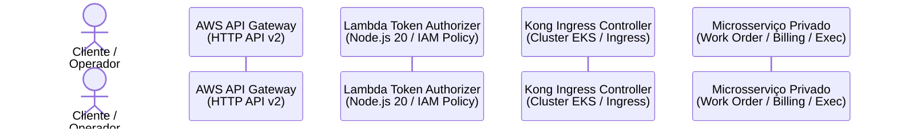

# Plano de Implementação: Separação Arquitetural AWS API Gateway e Kong no auth_token_authorizer.md

> **Decisão do Usuário**: Opção 1 - Separação Fidedigna: AWS API Gateway -> Lambda -> Kong -> Microsserviço
> **Status**: Aprovado para Execução

---

## 1. Contexto & Objetivos

Corrigir a ambiguidade arquitetural no documento `features/auth-lambda/auth_token_authorizer.md`, onde o **AWS API Gateway** e o **Kong Ingress Controller** estavam fundidos em um único participante.
Conforme provisionado no Terraform (`15soat-phase4-iac-lamda/main.tf` e `15soat-phase4-iac-k8s`), a cadeia perimetral de autorização e roteamento opera em dois níveis distintos:

1. **Borda Cloud AWS (Perímetro Serverless)**:
   - O **AWS API Gateway (HTTP API v2)** é o ponto de entrada público na internet.
   - O API Gateway invoca nativamente a **AWS Lambda Token Authorizer (`fiap-authorizer`)** através do recurso `aws_apigatewayv2_authorizer`.
   - A Lambda inspeciona o token Bearer JWT e retorna uma **IAM Policy (`Effect: "Allow"` ou `Effect: "Deny"`)**.
   - Em caso de `Deny` (token inválido ou revogado), o próprio AWS API Gateway encerra a requisição na borda retornando `403 Forbidden`, impedindo que tráfego não autorizado chegue ao cluster.
2. **Entrada no Cluster Kubernetes (Ingress Perimetral EKS)**:
   - Em caso de `Allow`, o AWS API Gateway encaminha a requisição HTTP com o contexto autenticado para o **Kong Ingress Controller** no cluster EKS.
   - O Kong Ingress executa o roteamento L7 para o Pod do microsserviço privado correspondente (`api-work-order`, `api-billing`, `api-exec`), que responde `200 OK`.

---

## 2. Participantes e Topologia (5 Participantes)

- **Dimensionamento ADR-004**:
  - Largura mínima do container configurada em `1250px` (faixa otimizada para 5 participantes: 1200px a 1300px).
  - Paridade estrita de activation boxes (`+` e `-`), sem caixas de ativação em atores humanos e quebras verticais ` `.

---

## 3. Critérios de Aceite

1. O participante híbrido `Gateway as AWS API Gateway / Kong Ingress` é substituído por dois participantes com papéis inequívocos: `APIGW as AWS API Gateway` e `Kong as Kong Ingress Controller`.
2. A invocação da Lambda Token Authorizer parte estritamente do `AWS API Gateway`.
3. O encaminhamento para o cluster Kubernetes ocorre via `Kong Ingress Controller` somente após a decisão de `Effect: "Allow"`.
4. Em caso de token inválido (`Effect: "Deny"`), o `403 Forbidden` é emitido pelo `AWS API Gateway` sem tocar no Kong nem no cluster.
5. `mvn process-test-resources test-compile` finaliza com **BUILD SUCCESS**.
6. Homologação com parecer **APROVADO** pelo subagente `code-reviewer-sentinel-subagent`.
