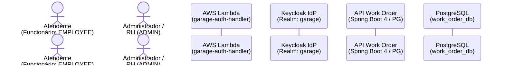

# Plano de Implementação: Atores Corporativos Exclusivos no user_identity_management (Atendente e Administrador)

> **Decisão do Usuário**: Opção 1 - Atores Corporativos Exclusivos: Atendente e Administrador
> **Status**: Aprovado para Execução

---

## 1. Contexto & Objetivos

Refinar o diagrama de sequência contido em `features/auth-lambda/user_identity_management.md` para representar estritamente os operadores corporativos do sistema de gestão de identidade e acesso (IAM), eliminando os atores `Cliente` e `Mecânico`, que não operam a função serverless de provisionamento:

1. **Atendente (`Ator as Atendente (Funcionário: EMPLOYEE)`)**:
   - Cadastra o cliente no balcão de recepção via **AWS Lambda** (`POST /users` com `role: "CUSTOMER"`).
   - Executa a **Saga Orquestrada em 2 Etapas**: Keycloak (IAM) + API Work Order (Catálogo/PostgreSQL).
   - Recebe o retorno em caso de sucesso (`201 Created`) ou em caso de **Rollback Compensatório** (`502 Bad Gateway` com exclusão automática da identidade no Keycloak caso a API Work Order falhe).
   - Realiza login (`POST /auth/login`) recebendo token JWT com `role: EMPLOYEE` para operar a plataforma.
2. **Administrador (`Admin as Administrador / RH (ADMIN)`)**:
   - Cadastra colaboradores da oficina via AWS Lambda (`POST /users` com `role: "EMPLOYEE"`).
   - Provisiona credenciais estritamente no Keycloak (**IAM Corporativo Puro**), sem acionar a API Work Order.
   - Realiza login (`POST /auth/login`) recebendo token JWT com `role: ADMIN`.

---

## 2. Participantes e Topologia (6 Participantes)

- **Dimensionamento ADR-004**:
  - Largura mínima do SVG configurada em `1400px`.
  - Preservada a nota perimetral `🔒 Sessão Autenticada via Token Authorizer (vide auth_token_authorizer.md)`.
  - Preservado o callout `[!NOTE]` com link navegável para `auth_token_authorizer.md`.

---

## 3. Critérios de Aceite

1. Os atores `Cliente` e `Mecânico` são completamente removidos do diagrama.
2. Apenas `Ator` (Atendente) e `Admin` figuram como atores humanos (sem activation boxes `+`/`-`).
3. O fluxo de onboarding do cliente permanece modelado como Saga Orquestrada com rollback compensatório disparado pelo Atendente.
4. `mvn process-test-resources test-compile` finaliza com **BUILD SUCCESS**.
5. Homologação com veredicto **APROVADO** pelo subagente `code-reviewer-sentinel-subagent`.
