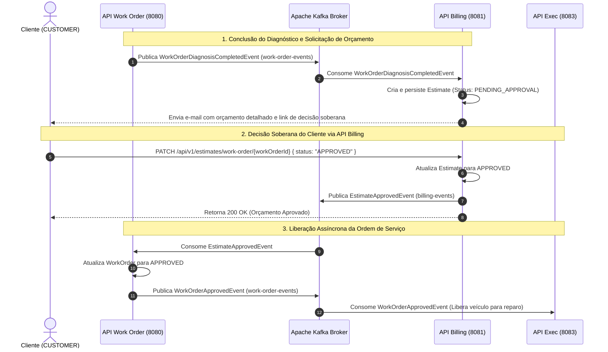

# Plano de Implementação: Ciclo de Vida de Orçamento (Estimate) e Migração para a API Billing

> **Decisão do Usuário**: Opção 1 - Design Canônico DDD com Entidade Estimate e Endpoint REST Canônico na API Billing
> **Status**: Aprovado para Execução

---

## 1. Visão Geral e Arquitetura Canônica

Este plano detalha a migração da responsabilidade de precificação preliminar, armazenamento do orçamento (*Estimate*), envio de e-mail ao cliente com o detalhamento dos custos e workflow soberano de aprovação/rejeição do cliente para o microsserviço **`api-billing`**, mantendo o desacoplamento de agregados e a coreografia de eventos via Apache Kafka.

---

## 2. Escopo de Alterações por Módulo

### 2.1. Documentação & Diagramas (`15soat-phase4-e2e`)
1. **`work_order_lifecycle.md`**:
   - Atualizar a Fase 3 e Fase 4 do diagrama Mermaid:
     - No passo 26, após cálculo dos itens diagnosticados, a `api-work-order` publica evento Kafka para o `api-billing`.
     - O `api-billing` consome, persiste a entidade `Estimate` e envia o e-mail de orçamento ao cliente.
     - Na Fase 4, a chamada de aprovação do cliente é direcionada para a `api-billing` (`PATCH /api/v1/estimates/work-order/{workOrderId}`).
     - A `api-billing` publica `EstimateApprovedEvent` no Kafka, a `api-work-order` consome e libera a OS para `APPROVED`.
2. **`work_order_lifecycle.feature` & `work_order_lifecycle-non-func.feature`**:
   - Atualizar os cenários para refletir a aprovação do orçamento via endpoint de Estimate do Billing e verificar a transição da OS no Work Order.

### 2.2. Microsserviço de Faturamento (`15soat-phase4-api-billing`)
1. **Banco de Dados (Flyway)**:
   - Criar `V2__create_estimate_schema.sql` com tabelas `estimate` e `estimate_item`.
2. **Domínio e Modelagem DDD**:
   - Criar `Estimate`, `EstimateItem`, `EstimateStatus` (`PENDING_APPROVAL`, `APPROVED`, `REJECTED`).
   - Métodos de negócio: `approve()`, `reject(String reason)`.
3. **Portas & Casos de Uso**:
   - `CreateEstimateUseCase`, `ApproveEstimateUseCase`, `GetEstimateUseCase`.
   - `EstimateRepositoryPort`, `EstimateEventPublisherPort`, `NotificationPort`.
4. **Contratos OpenAPI & AsyncAPI**:
   - Definir `PATCH /api/v1/estimates/work-order/{workOrderId}` em `openapi.yaml`.
   - Definir eventos `EstimateApprovedEvent` e `EstimateRejectedEvent` em `asyncapi.yaml`.
5. **Adaptadores Web, Kafka e Notificação**:
   - `EstimateController` implementando `EstimateApi`.
   - Consumer Kafka para consumir diagnóstico e gerar o orçamento.
   - Producer Kafka para emitir aprovação/recusa.
   - Envio simulado de e-mail ao cliente com o detalhamento dos valores e link de decisão.

### 2.3. Microsserviço de Ordem de Serviço (`15soat-phase4-api-work-order`)
1. **Remoção de Endpoint Redundante**:
   - Remover a operação de aprovação manual direta de status da OS do controller `PATCH /api/v1/work-orders/{id}` e do `openapi.yaml`.
2. **Consumo de Eventos Kafka**:
   - Implementar listener no tópico `billing-events` para consumir `EstimateApprovedEvent` (atualiza OS para `APPROVED`) e `EstimateRejectedEvent` (atualiza OS para `CANCELED` e libera reserva de estoque).
3. **Publicação de Diagnóstico**:
   - Emitir evento com itens orçados após a conclusão do diagnóstico técnico.

### 2.4. Testes de Integração e E2E (`15soat-phase4-e2e`)
1. Atualizar step definitions para cobrir a criação do orçamento no Billing, envio de aprovação para `/api/v1/estimates/work-order/{workOrderId}` e validação da liberação assíncrona da OS no Work Order.
2. Executar suíte completa de testes com preflight local e validação pelo subagente sentinela.

---

## 3. Critérios de Aceite e Garantias
- 100% dos testes unitários e de integração verdes.
- Diagrama de sequência sincronizado rigorosamente com a especificação funcional (`.feature`).
- Sem commits ou pushes automáticos sem aprovação prévia do usuário.
