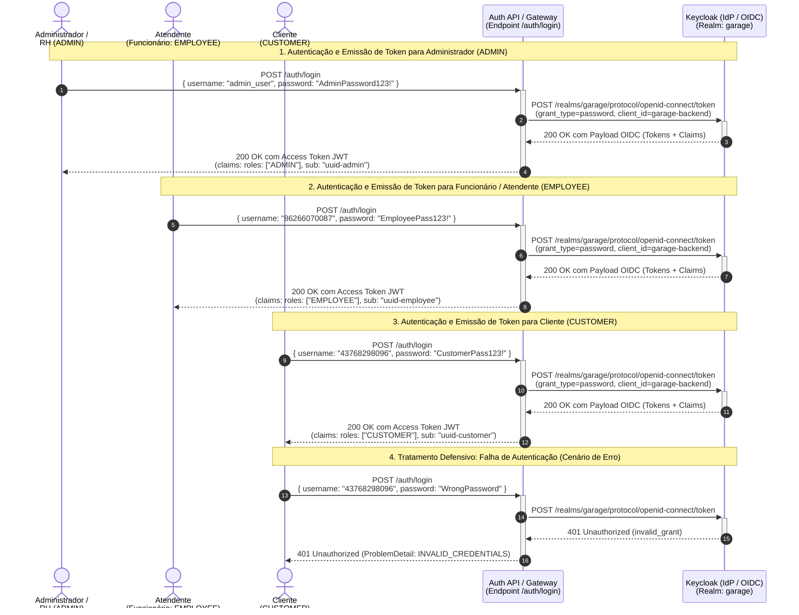

## Diagrama de Sequência

**Autenticação de Usuários e Emissão de Tokens JWT (Referência: `user_authentication.md`)**

Este diagrama documenta a arquitetura de autenticação centralizada e emissão de tokens de acesso baseada em **OpenID Connect (OIDC)** e **OAuth 2.0**:
1. **Ponto Único de Login (`POST /auth/login`)**: Todos os atores da plataforma (Administrador, Funcionário e Cliente) autenticam-se através do endpoint unificado de autenticação, enviando suas credenciais seguras (usuário/documento e senha).
2. **Delegação ao Identity Provider (Keycloak)**: O serviço de autenticação consome internamente o Token Endpoint do **Keycloak** (`/realms/garage/protocol/openid-connect/token`) via fluxo padrão `grant_type=password`.
3. **Emissão de Tokens com Perfis Segregados**:
   - **Administrador (`ADMIN`)**: Token com privilégios totais de gestão de usuários e catálogos.
   - **Funcionário / Atendente (`EMPLOYEE`)**: Token com permissões operacionais para ordens de serviço, veículos e execuções técnicas.
   - **Cliente (`CUSTOMER`)**: Token restrito para acompanhamento de ordens de serviço e pagamentos próprios.
4. **Tratamento Defensivo de Falhas**: Em caso de credenciais incorretas, o Keycloak recusa a emissão com `401 Unauthorized`, e a API retorna uma resposta padronizada no padrão RFC 7807 (`ProblemDetail`).

> [!NOTE]
> **Gestão de Identidades**:
> O gerenciamento e cadastro prévio dos usuários no Keycloak e catálogo estão documentados em [user_identity_management.md](user_identity_management.md).

---

