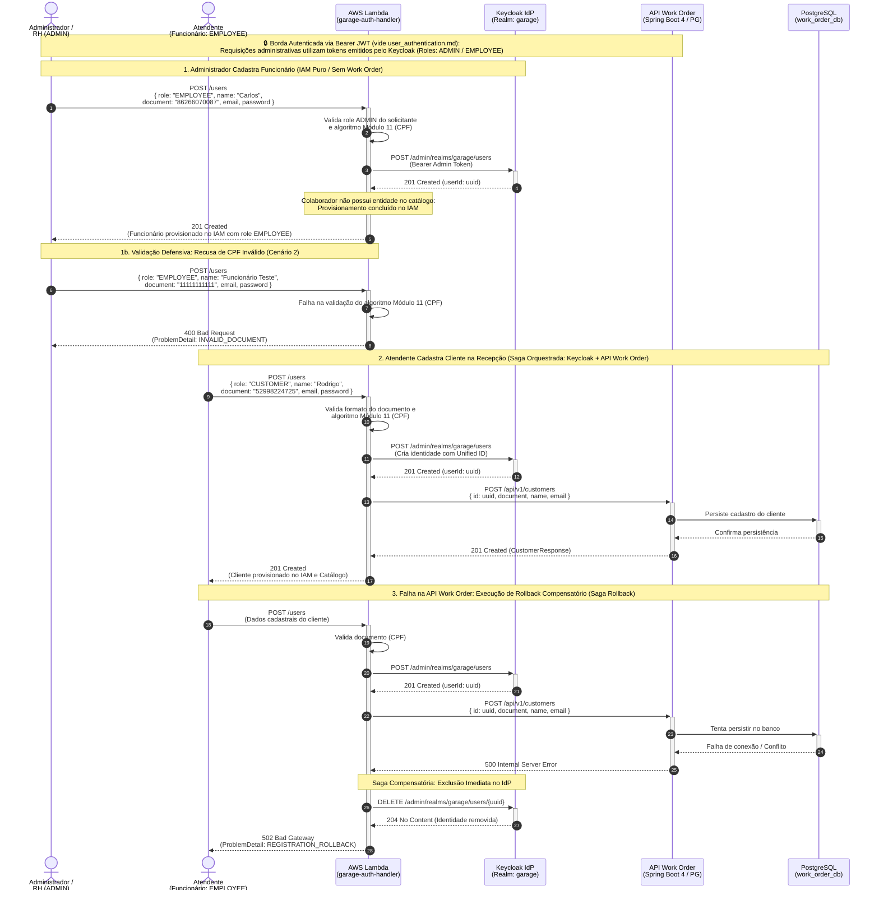

## Diagrama de Sequência

**Gestão e Provisionamento de Identidades de Usuários (Referência: `user_identity_management.feature`)**

Este diagrama documenta o provisionamento de identidades e gerenciamento corporativo via Serverless & Keycloak (IAM) na ordem cronológica de operação:
1. **Administrador Cadastra Funcionário (IAM Corporativo Puro)**: O Administrador/RH provisiona colaboradores da oficina (`POST /users` com role `EMPLOYEE`), gerenciados estritamente no **Keycloak (IdP)**. A API Work Order não gerencia funcionários e não é acionada.
2. **Validação Defensiva de Documento (400 Bad Request)**: Tentativas de provisionamento com CPF inválido são rejeitadas de imediato na Lambda pelo algoritmo Módulo 11 sem onerar o IdP.
3. **Atendente Cadastra Cliente (Saga Orquestrada em 2 Etapas)**: Com o acesso liberado, o Atendente atende o cliente no balcão da oficina via **AWS Lambda** (`POST /users` com role `CUSTOMER`), que valida o CPF (Módulo 11 da Receita Federal), provisiona a identidade no **Keycloak (IdP)** e propaga os dados para a **API Work Order** (`POST /api/v1/customers`).
4. **Saga Compensatória (Rollback)**: Caso a **API Work Order** falhe ou apresente indisponibilidade no banco, a Lambda executa imediatamente a compensação distribuída (`DELETE /admin/realms/garage/users/{uuid}`) no Keycloak, retornando erro 502 ao Atendente.

> [!NOTE]
> **Autenticação OIDC & Emissão de JWT**:
> O fluxo de login e emissão de tokens de acesso JWT via Keycloak está documentado em [user_authentication.md](user_authentication.md).

