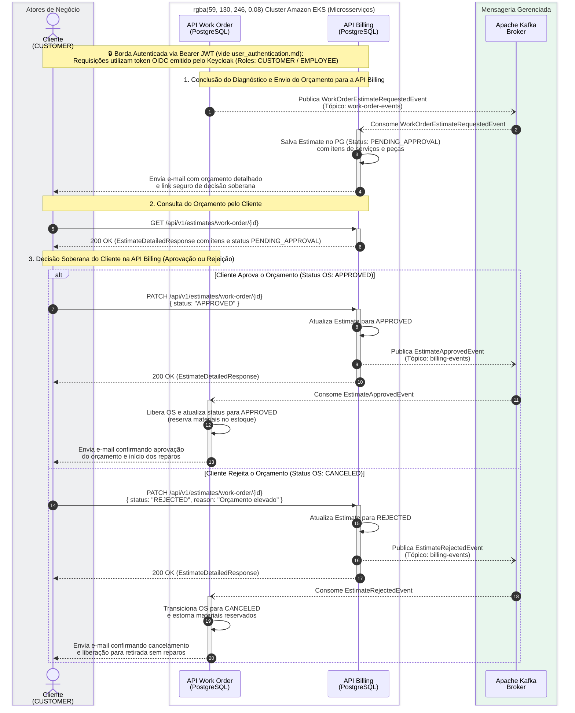

# Documentação Viva: Ciclo de Vida do Orçamento na API Billing

## Visão Geral

Este documento descreve a governança de orçamentos (*Estimates*) centralizada no microsserviço `15soat-phase4-api-billing`. O orçamento é originado a partir da conclusão do diagnóstico técnico na oficina (`15soat-phase4-api-work-order`) e submetido à decisão soberana do cliente.

> [!NOTE]
> **🔒 Autenticação & Emissão de JWT**: A obtenção e emissão de tokens Bearer JWT via Keycloak estão detalhadas no diagrama [user_authentication.md](../auth-lambda/user_authentication.md).

---

---

## Contratos REST

### `GET /api/v1/estimates/work-order/{workOrderId}`
- **Descrição**: Retorna o orçamento detalhado da Ordem de Serviço, com status atual e itens discriminados.
- **Autenticação**: Requer perfil `CUSTOMER` ou `EMPLOYEE`.

### `PATCH /api/v1/estimates/work-order/{workOrderId}`
- **Descrição**: Processa a decisão soberana do cliente sobre o orçamento (`APPROVED` ou `REJECTED`).
- **Autenticação**: Requer perfil `CUSTOMER` (SoD - funcionários não podem aprovar).
- **Efeitos Colaterais**: Publicação de `EstimateApprovedEvent` ou `EstimateRejectedEvent` no tópico `billing-events`.
