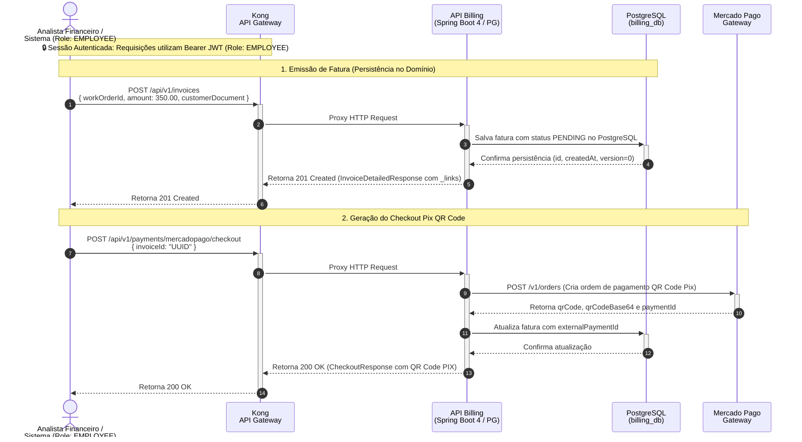

## Diagrama de Sequência

**Geração de Faturas e Checkout Mercado Pago (Referência: `invoice_generation.feature`)**

Este diagrama documenta a arquitetura em duas etapas da API de Faturamento:
1. **Emissão e Registro da Fatura** no PostgreSQL (`POST /api/v1/invoices`).
2. **Geração do Checkout Pix Mercado Pago** (`POST /api/v1/payments/mercadopago/checkout`) em conformidade com o contrato **OpenAPI 3.0** (`openapi.yaml` e `mercadopago-api.yaml`).

