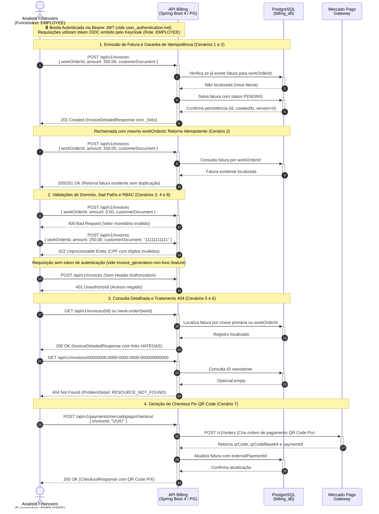

## Diagrama de Sequência

**Geração de Faturas, Validações e Checkout Mercado Pago (Referência: `invoice_generation.feature`)**

Este diagrama documenta a arquitetura completa da API de Faturamento cobrindo todos os cenários da especificação BDD em conformidade com o contrato **OpenAPI 3.0** (`openapi.yaml` e `mercadopago-api.yaml`):
1. **Emissão e Idempotência (`POST /api/v1/invoices`)**: Criação da fatura com status `PENDING` no PostgreSQL (Cenário 1) e garantia de idempotência retornando o registro existente em chamadas duplicadas para a mesma Ordem de Serviço (Cenário 2).
2. **Validações de Domínio e Segurança**: Rejeição de valores menores ou iguais a zero com `400 Bad Request` (Cenário 3), documento de cliente inválido com `422 Unprocessable Entity` (Cenário 4) e bloqueio por ausência de credenciais com `401 Unauthorized` (vide [invoice_generation-non-func.feature](invoice_generation-non-func.feature)).

3. **Recuperação e Consulta Detalhada (`GET /api/v1/invoices/{id}` e `/work-order/{woId}`)**: Recuperação da fatura com links HATEOAS canônicos (Cenário 5) e tratamento defensivo `404 Not Found` para faturas inexistentes (Cenário 6).
4. **Geração do Checkout Pix Mercado Pago (`POST /api/v1/payments/mercadopago/checkout`)**: Criação da ordem Pix com QR Code e persistência do `externalPaymentId` (Cenário 7).

> [!NOTE]
> **🔒 Autenticação & Emissão de JWT**: A obtenção e emissão de tokens Bearer JWT via Keycloak estão detalhadas no diagrama [user_authentication.md](../auth-lambda/user_authentication.md).

