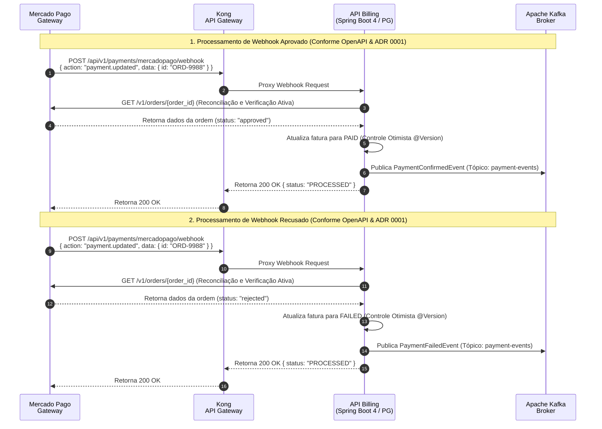

## Diagrama de Sequência

**Processamento de Webhooks de Pagamento e Liquidação (Referência: `payment_webhook_processing.feature`)**

Este diagrama documenta o recebimento e reconciliação dos webhooks do Mercado Pago, em total conformidade com a especificação **OpenAPI 3.0** (`openapi.yaml` e `mercadopago-api.yaml`) e a **ADR 0001 (Processamento Idempotente de Webhooks)**. Cobre o fluxo de aprovação e o fluxo de recusa com verificação ativa (*pull verification*) e publicação de eventos transacionais na Saga coreografada via Apache Kafka.

