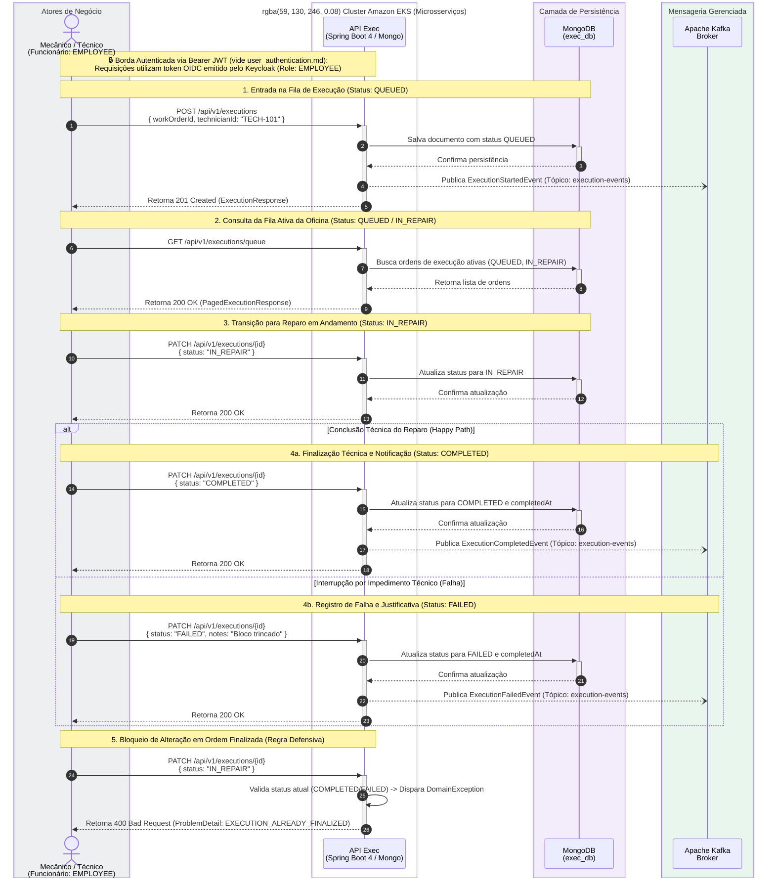

## Diagrama de Sequência

**Gerenciamento da Fila de Oficina e Execução de Reparos (Referência: `execution_queue_and_repair.feature`)**

Este diagrama documenta a entrada do veículo na fila de oficina, avanço de status durante os reparos e finalização técnica com persistência documental no MongoDB e emissão de eventos no Kafka:
1. **Entrada na Fila Operacional (`POST /api/v1/executions`)**: Registro do veículo com status `QUEUED` e emissão do evento `ExecutionStartedEvent`.
2. **Consulta e Triagem das Baias (`GET /api/v1/executions/queue`)**: Recuperação de ordens ativas nos estados `QUEUED` e `IN_REPAIR`.
3. **Início e Evolução do Reparo (`PATCH /api/v1/executions/{id}`)**: Transição de estado com persistência documental no MongoDB.
4. **Finalização Técnica ou Bloqueio**: Conclusão (`COMPLETED`) com publicação de `ExecutionCompletedEvent` ou interrupção por falha técnica (`FAILED`) com publicação de `ExecutionFailedEvent`.
5. **Bloqueio Defensivo de Mutações**: Rejeição via RFC 7807 (`EXECUTION_ALREADY_FINALIZED`) em caso de tentativa de alteração em execução já encerrada.

> [!NOTE]
> **🔒 Autenticação & Emissão de JWT**: A obtenção e emissão de tokens Bearer JWT via Keycloak estão detalhadas no diagrama [user_authentication.md](../auth-lambda/user_authentication.md).

---

