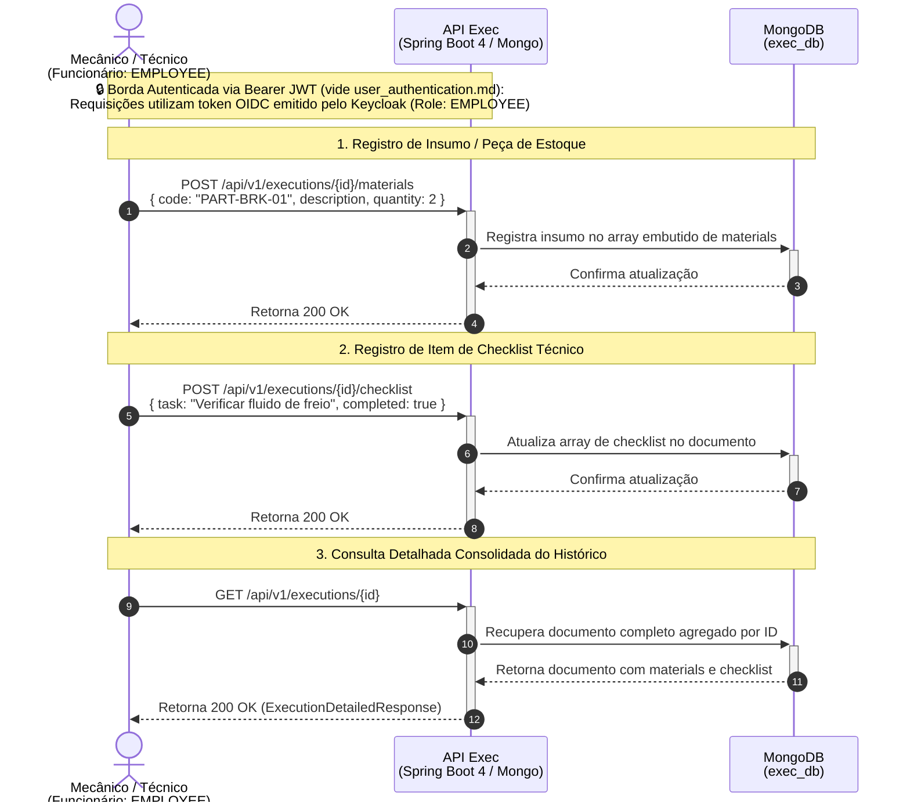

## Diagrama de Sequência

**Gestão de Materiais de Estoque e Checklists Técnicos (Referência: `materials_and_checklist.feature`)**

Este diagrama documenta o lançamento de insumos e preenchimento de checklists operacionais de inspeção com persistência documental no MongoDB:
1. **Lançamento de Insumos e Peças (`POST /api/v1/executions/{id}/materials`)**: Registro estruturado de materiais aplicados na ordem com persistência em array embutido no MongoDB.
2. **Preenchimento de Checklists de Inspeção (`POST /api/v1/executions/{id}/checklist`)**: Validação e atualização de itens de conferência veicular e segurança.
3. **Consulta Consolidada do Agregado (`GET /api/v1/executions/{id}`)**: Recuperação integral do documento de execução com insumos e itens de checklist.

> [!NOTE]
> **🔒 Autenticação & Emissão de JWT**: A obtenção e emissão de tokens Bearer JWT via Keycloak estão detalhadas no diagrama [user_authentication.md](../auth-lambda/user_authentication.md).

