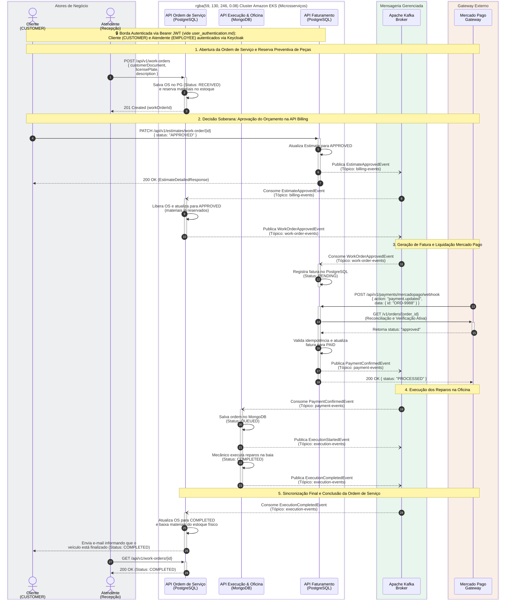
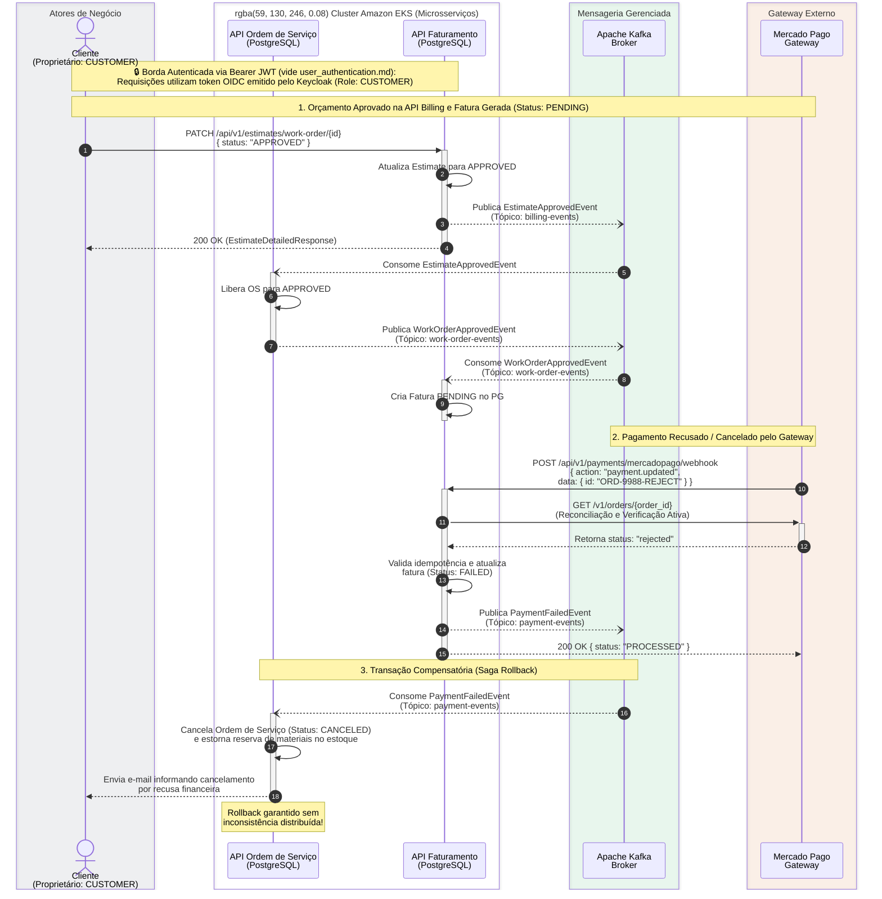
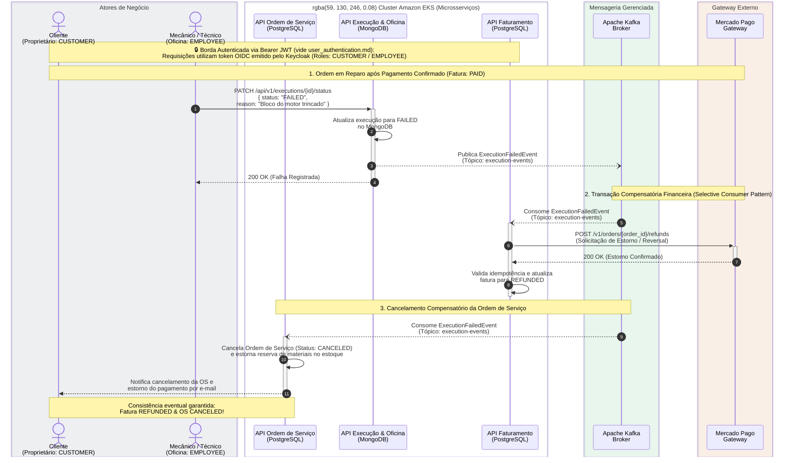
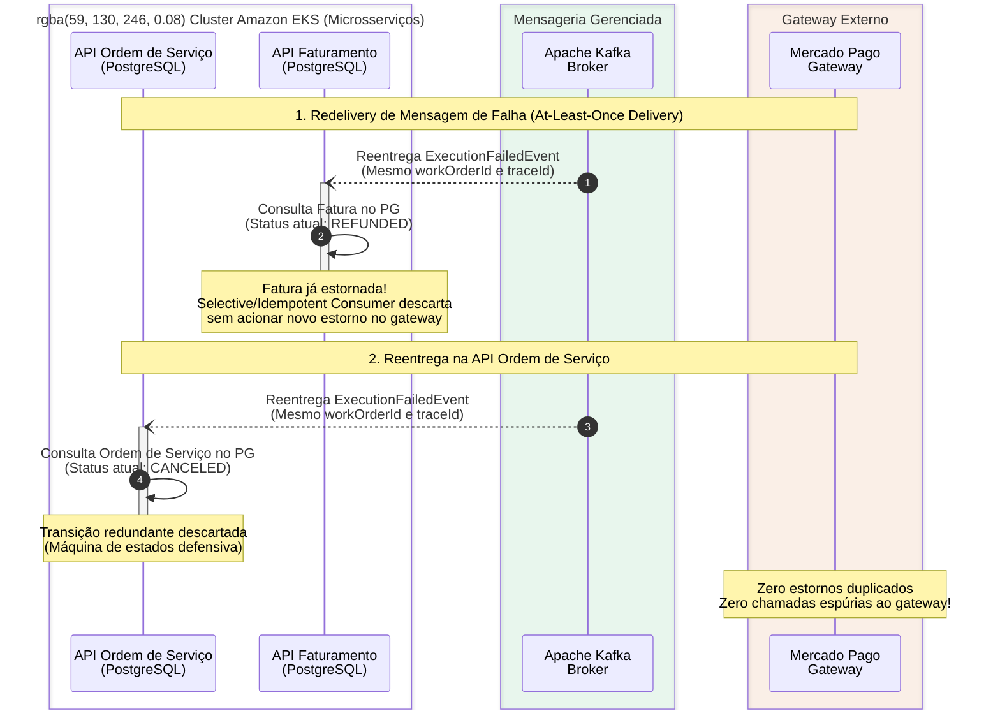

## Diagramas de Sequência da Saga Distribuída Coreografada

**Referência Canônica: `choreographed_saga.feature` e ADR-004**

Este documento consolida a especificação arquitetural visual da **Saga Distribuída Coreografada** via Apache Kafka entre os microsserviços `api-work-order`, `api-billing` e `api-exec`, integrados ao **Mercado Pago** e protegidos por autenticação perimetral com **Keycloak (OIDC)**.

O ecossistema adota coreografia assíncrona orientada a eventos para garantir consistência eventual em 4 dimensões:
1. **Fluxo Principal (Happy Path)**: Do ingresso do veículo à entrega com quitação e reparos concluídos.
2. **Rollback Compensatório por Recusa de Pagamento**: Cancelamento defensivo da Ordem de Serviço perante rejeição do gateway financeiro com liberação de materiais.
3. **Rollback Compensatório com Estorno Financeiro**: Falha irrecuperável na oficina dispara estorno ativo no Mercado Pago (`REFUNDED`), cancelamento da OS (`CANCELED`) e estorno de insumos reservados.
4. **Idempotência de Compensação**: Tolerância contra reentregas de mensagens (*At-Least-Once Delivery*) prevenindo estornos duplicados e inconsistência de estados.

> [!TIP]
> **Relação com o Ciclo de Vida da Ordem de Serviço**:
> Este documento foca especificamente nos cenários de **Engenharia de Sistemas Distribuídos e Padrão Saga Coreografada** (Happy Path, Rollbacks Compensatórios e Idempotência). O fluxo operacional exaustivo da oficina mecânica física (todas as 8 fases da recepção à entrega) está documentado em [`work_order_lifecycle.md`](../work-order/work_order_lifecycle.md).

> [!NOTE]
> **🔒 Autenticação & Emissão de JWT**: A obtenção e emissão de tokens Bearer JWT via Keycloak estão detalhadas no diagrama [user_authentication.md](../auth-lambda/user_authentication.md).

---

### Cenário 1: Caminho Feliz - Ciclo Completo da Saga com Sucesso

---

### Cenário 2: Rollback Compensatório por Recusa de Pagamento

---

### Cenário 3: Rollback Compensatório com Estorno Financeiro por Falha na Oficina

---

### Cenário 4: Idempotência do Estorno Compensatório perante Notificações Repetidas

