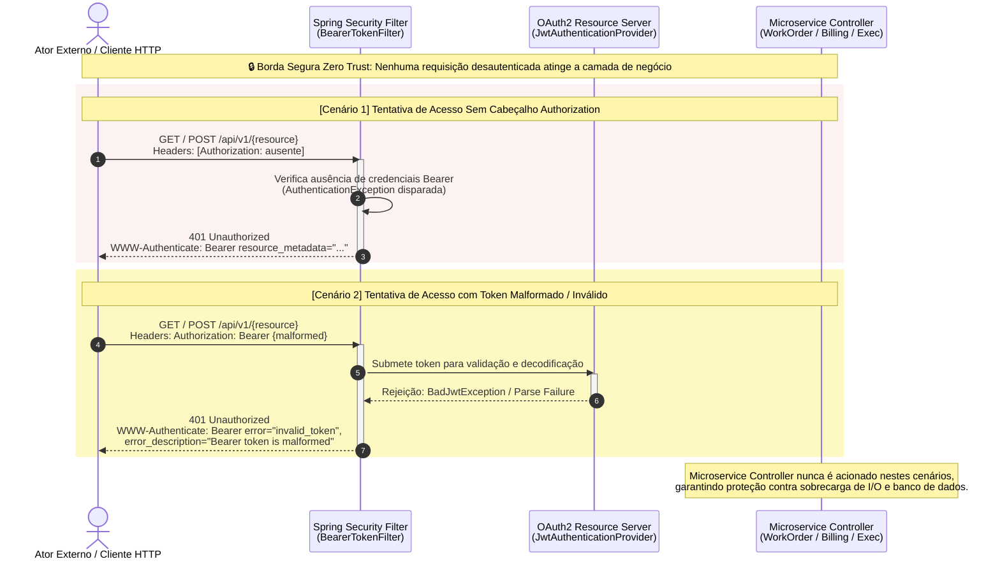

# Diagrama de Sequência: Validação Transversal de Segurança e Autenticação de APIs

> **Status**: Aprovado  
> **Referência Normativa**: [ADR-004: Padrão Visual para Diagramas de Sequência Mermaid](../../docs/adr/004-padrao-visual-diagramas-sequencia-mermaid.md)  
> **Especificação BDD Associada**: [cross_api_authentication_guardrails.feature](cross_api_authentication_guardrails.feature)  
> **Origem dos Tokens Válidos**: [user_authentication.md](../auth-lambda/user_authentication.md)

---

## 1. Visão Geral da Arquitetura de Segurança (Defense-in-Depth)

No modelo Zero Trust adotado pela Fase 4, nenhuma chamada interna ou externa trafega desprotegida. Todas as APIs (`work-order`, `billing`, `exec`) operam como **OAuth2 Resource Servers** protegidos por filtros do Spring Security (`BearerTokenAuthenticationFilter` e `SecurityFilterChain`).

Qualquer requisição que atinja os microsserviços sem o cabeçalho `Authorization: Bearer <token>` ou contendo um token sintaticamente malformado, forjado ou expirado é **imediatamente interceptada e rejeitada na camada de filtro web**, antes mesmo de invocar o Controller de negócio ou consumir recursos do banco de dados ou mensageria.

---

## 2. Diagrama de Sequência: Bloqueio Transversal de Requisições Não Autenticadas (HTTP 401)

---

## 3. Matriz de Paridade com os Cenários BDD

| Cenário Gherkin | Rota / Método Auditado | Comportamento de Interceptação | Status HTTP |
| :--- | :--- | :--- | :---: |
| **Cenário 1: Token Ausente** | Todas as rotas de `work-order`, `billing`, `exec` | Interceptado no `BearerTokenAuthenticationFilter` por ausência de credenciais | **401 Unauthorized** |
| **Cenário 2: Token Malformado** | Todas as rotas de `work-order`, `billing`, `exec` | Interceptado na tentativa de parsing do token (`BadJwtException`) | **401 Unauthorized** |
