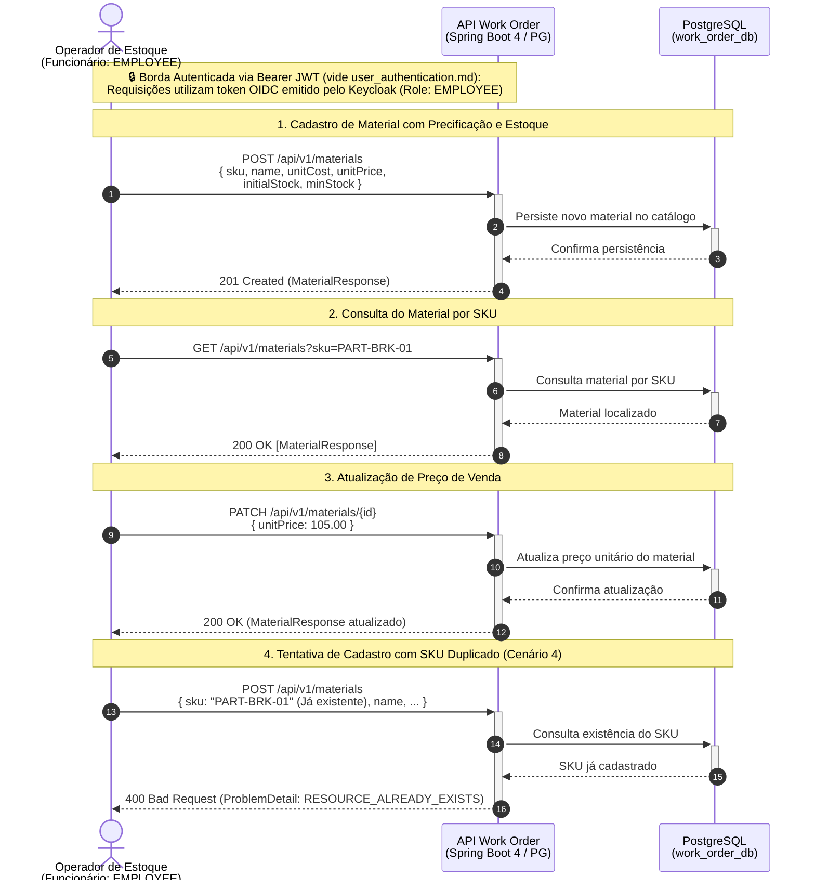

## Diagrama de Sequência

**Gestão e Precificação de Materiais (Referência: `material_management.feature`)**

Este diagrama documenta o gerenciamento do estoque e da precificação de insumos operacionais no microsserviço de Ordens de Serviço:
1. **Cadastro de Material no Catálogo (`POST /api/v1/materials`)**: Provisionamento de peças com SKU, custo unitário, preço de venda e margens de estoque mínimo (Cenário 1).
2. **Consulta e Localização por SKU (`GET /api/v1/materials?sku=...`)**: Recuperação de especificações técnicas e disponibilidade de insumos (Cenário 2).
3. **Atualização Dinâmica de Preço de Venda (`PATCH /api/v1/materials/{id}`)**: Ajuste de precificação comercial com controle transacional e versionamento (Cenário 3).
4. **Tratamento de Sad Path (SKU Duplicado)**: Rejeição com código `400 Bad Request` perante tentativa de cadastro de SKU já existente na base (Cenário 4).

> [!NOTE]
> **🔒 Autenticação & Emissão de JWT**: A obtenção e emissão de tokens Bearer JWT via Keycloak estão detalhadas no diagrama [user_authentication.md](../auth-lambda/user_authentication.md).

---

