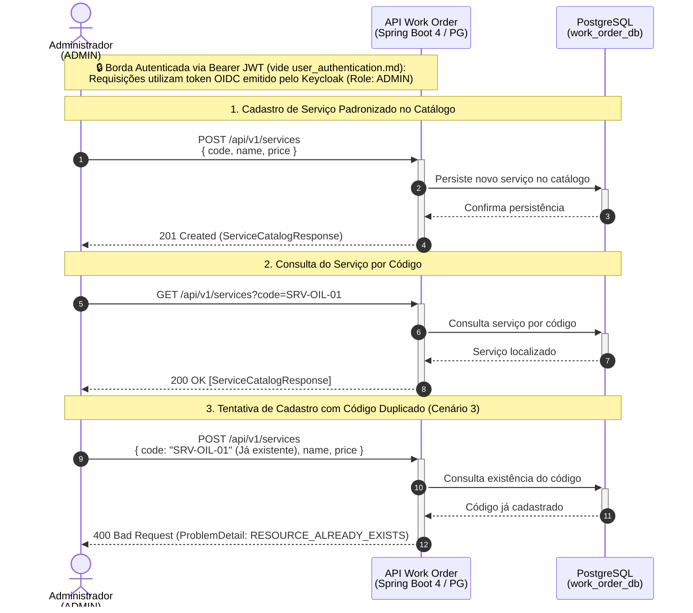

## Diagrama de Sequência

**Gestão do Catálogo de Serviços (Referência: `service_catalog_management.feature`)**

Este diagrama documenta a gestão e padronização dos serviços oferecidos pela oficina no catálogo corporativo:
1. **Cadastro de Serviço Padronizado (`POST /api/v1/services`)**: Provisionamento administrativo de tipos de serviços com código único e tabela de preços (Cenário 1).
2. **Consulta e Localização de Serviço por Código (`GET /api/v1/services?code=...`)**: Recuperação rápida de procedimentos e valores vigentes para montagem de orçamentos (Cenário 2).
3. **Tratamento de Sad Path (Código Duplicado)**: Rejeição com código `400 Bad Request` perante tentativa de cadastro de serviço com código já existente na base (Cenário 3).

> [!NOTE]
> **🔒 Autenticação & Emissão de JWT**: A obtenção e emissão de tokens Bearer JWT via Keycloak estão detalhadas no diagrama [user_authentication.md](../auth-lambda/user_authentication.md).

---

