## Diagrama de Sequência: Ciclo de Vida da Ordem de Serviço (Arquitetura Orientada a Eventos)

**Referência Canônica: `work_order_lifecycle.feature` e ADR-004**

Este diagrama documenta o fluxo operacional completo das 8 fases da Ordem de Serviço (OS) com **segregação estrita de responsabilidades**, **notificações por e-mail ao Cliente e Mecânico**, **decisão soberana pelo Cliente via e-mail (aprovação ou recusa do orçamento)**, **gestão de faturas e pagamentos pelo Billing Service integrado ao Mercado Pago** e **comunicação assíncrona orientada a eventos via Apache Kafka**:

1. **Cliente (Proprietário: CUSTOMER)**: Comparece à oficina, entrega o veículo e as chaves ao Atendente relatando os serviços desejados. **Recebe notificação por e-mail a cada alteração de situação da Ordem de Serviço** (`RECEIVED`, `DIAGNOSING`, `WAITING_APPROVAL`, `APPROVED` / `CANCELED`, `EXECUTING`, `COMPLETED`, `PAID`, `DELIVERED`). Recebe por e-mail da **API Billing** o orçamento detalhado (**Estimate**) com a composição de custos e o **link seguro de decisão** e aprova formalmente a execução dos serviços (`APPROVED`) ou rejeita a proposta (`REJECTED`) diretamente na **API Billing**. Após a finalização dos reparos e emissão da fatura, recebe um único e-mail consolidado com a confirmação de conclusão do veículo e o QR Code PIX / boleto do Mercado Pago para quitação online e, após a confirmação de pagamento (`PAID`), comparece à recepção na Fase 8 para retirar o veículo reparado com o atendente.
2. **Atendente (Recepção: EMPLOYEE)**: Recebe o veículo do cliente na oficina, cadastra a abertura da OS (`RECEIVED`) na **API Work Order** (`api-work-order`) com token OIDC autenticado pelo Keycloak, entrega o protocolo ao cliente, realiza a liberação final (`DELIVERED`) e entrega as chaves e o veículo reparado ao cliente após validação de quitação. **O atendente não aprova o orçamento e, por ser ator humano, não possui caixas de ativação de thread**.
3. **Mecânico (Oficina: EMPLOYEE)**: Interage **exclusivamente com a API Exec** (`api-exec`) com perfil operacional autenticado para consulta da fila de produção (`GET /api/v1/executions/queue`), execução do diagnóstico técnico, preenchimento de checklists dinâmicos (`POST /api/v1/executions/{id}/checklist`) e atualizações de status da baia (`PATCH /api/v1/executions/{id}/status`). **Recebe e-mail quando há novos veículos na fila de execução** e **recebe e-mail quando o orçamento for aprovado pelo cliente** para início dos reparos. O mecânico **não realiza chamadas diretas** contra a `api-work-order` nem contra a `api-billing`.
4. **API Billing (Faturamento, Orçamentos & Mercado Pago: `api-billing`)**: Responsável por consumir eventos de levantamento de diagnóstico da **API Work Order** (`WorkOrderEstimateRequestedEvent`), persistir e gerenciar o ciclo de vida dos orçamentos (**Estimate**), enviar e-mails de orçamento com a cobrança proposta e links de decisão soberana ao Cliente, processar a aprovação/recusa soberana do Cliente (`PATCH /api/v1/estimates/work-order/{workOrderId}`), publicar `EstimateApprovedEvent` para que a **API Work Order** libere a OS para execução, emitir faturas finais pós-reparo, gerar checkout PIX no Mercado Pago, registrar pagamentos recebidos via webhook e publicar eventos de quitação (`PaymentConfirmedEvent`).
5. **Mercado Pago (Gateway de Pagamento)**: Provedor externo integrado ao `api-billing` para geração de QR Code PIX / Checkout e notificação assíncrona via Webhooks com garantia de concorrência e idempotência.
6. **Coreografia Assíncrona via Kafka**: A sincronização de estados entre o ciclo de vida da OS (PostgreSQL), execução na oficina (MongoDB) e faturamento (PostgreSQL) ocorre de ponta a ponta através de eventos distribuídos nos tópicos `work-order-events`, `execution-events`, `billing-events` e `payment-events`.

> [!TIP]
> **Hub de Navegação dos Subfluxos Especializados**:
> - **Onboarding de Cliente e Veículo**: Fluxo cadastral orquestrado entre Keycloak e API Work Order em [`customer_vehicle_management.md`](./customer_vehicle_management.md).
> - **Catálogo de Serviços e Estoque de Peças**: Parametrização prévia de mão de obra e insumos em [`service_catalog_management.md`](./service_catalog_management.md) e [`material_management.md`](./material_management.md).
> - **Fila de Oficina e Execução Técnica**: Gestão da esteira de baias, alocação de mecânico e checklists em [`execution_queue_and_repair.md`](../exec/execution_queue_and_repair.md) e [`materials_and_checklist.md`](../exec/materials_and_checklist.md).
> - **Faturamento e Reconciliação PIX**: Emissão de faturas e processamento idempotente de webhooks em [`invoice_generation.md`](../billing/invoice_generation.md) e [`payment_webhook_processing.md`](../billing/payment_webhook_processing.md).

> [!NOTE]
> **🔒 Autenticação & Emissão de JWT**: A obtenção e emissão de tokens Bearer JWT via Keycloak estão detalhadas no diagrama [user_authentication.md](../auth-lambda/user_authentication.md).

---

```mermaid
sequenceDiagram
    autonumber
    box rgba(100, 116, 139, 0.08) Atores de Negócio
        actor Cli as Cliente<br/>(CUSTOMER)
        actor Mec as Mecânico<br/>(Oficina)
        actor Ator as Atendente<br/>(Recepção)
    end
    box rgba(59, 130, 246, 0.08) Cluster Amazon EKS (Microsserviços)
        participant WO as API Work Order<br/>(PostgreSQL)
        participant Exec as API Exec<br/>(MongoDB)
        participant Billing as API Billing<br/>(PostgreSQL)
    end
    box rgba(34, 197, 94, 0.08) Mensageria Gerenciada
        participant Kafka as Apache Kafka<br/>Broker
    end
    box rgba(249, 115, 22, 0.08) Gateway Externo
        participant MP as Mercado Pago<br/>Gateway
    end

    Note over Cli,Billing: 🔒 Borda Autenticada via Bearer JWT (vide user_authentication.md):<br/>Todas as requisições autenticadas utilizam tokens OIDC emitidos pelo Keycloak

    %% -------------------------------------------------------------------------
    %% 1. Recepção do Veículo e Entrada na Fila
    %% -------------------------------------------------------------------------
    Note over Cli,MP: 1. Recepção do Veículo na Oficina e Entrada na Fila<br/>(Status OS: RECEIVED ➔ Fila: QUEUED)
    Note over Cli,WO: 🔗 Subfluxo Prévio: Onboarding de Cliente/Veículo (customer_vehicle_management.md)
    Note over Cli,WO: 🔗 Subfluxo Prévio: Catálogo de Serviços (service_catalog_management.md)
    Note over Cli,WO: 🔗 Subfluxo Prévio: Catálogo e Estoque de Peças (material_management.md)
    Cli->>Ator: Deixa o veículo na oficina,<br/>entrega as chaves e solicita revisão
    Ator->>+WO: POST /api/v1/work-orders<br/>{ customerDocument,<br/>  licensePlate,<br/>  description }
    WO->>WO: Salva OS no PG (Status: RECEIVED)<br/>e reserva materiais no estoque
    WO--)Kafka: Publica WorkOrderCreatedEvent<br/>(Tópico: work-order-events)
    WO-->>Cli: Envia e-mail informando abertura da OS<br/>e entrada na fila do mecânico
    WO-->>-Ator: Retorna 201 Created (WorkOrderResponse)
    Ator-->>Cli: Confirma abertura da OS<br/>e entrega protocolo
    Kafka--)Exec: Consome WorkOrderCreatedEvent
    activate Exec
    Exec->>Exec: Salva ordem no MongoDB<br/>(Status: QUEUED)
    Exec-->>Mec: Envia e-mail de notificação<br/>de novo veículo na fila
    deactivate Exec

    %% -------------------------------------------------------------------------
    %% 2. Diagnóstico Técnico na Oficina e Notificação de Início ao Cliente
    %% -------------------------------------------------------------------------
    Note over Cli,MP: 2. Diagnóstico Técnico na Oficina e Notificação de Início ao Cliente<br/>(Status OS: DIAGNOSING)
    Note over Mec,Exec: 🔗 Subfluxo Dedicado: Fila de Oficina e Triagem (../exec/execution_queue_and_repair.md)
    Mec->>+Exec: GET /api/v1/executions/queue
    Exec->>Exec: Consulta fila no MongoDB
    Exec-->>-Mec: Retorna 200 OK com fila<br/>(PagedExecutionResponse)

    Mec->>+Exec: PATCH /api/v1/executions/{id}/status<br/>{ status: "DIAGNOSIS",<br/>  notes: "Iniciando diagnóstico" }
    Exec->>Exec: Atualiza status para DIAGNOSIS<br/>e anotações no MongoDB
    Exec--)Kafka: Publica ExecutionStatusChangedEvent<br/>(Tópico: execution-events)
    Exec-->>-Mec: Retorna 200 OK (ExecutionDetailedResponse)
    Kafka--)WO: Consome ExecutionStatusChangedEvent
    activate WO
    WO->>WO: Atualiza status da OS<br/>para DIAGNOSING
    WO-->>Cli: Envia e-mail informando que o<br/>diagnóstico do veículo foi iniciado
    deactivate WO

    %% -------------------------------------------------------------------------
    %% 3. Conclusão do Diagnóstico e Precificação na API Work Order & Envio para API Billing
    %% -------------------------------------------------------------------------
    Note over Cli,MP: 3. Conclusão do Diagnóstico e Envio do Orçamento (Estimate) para API Billing<br/>(Status OS: WAITING_APPROVAL)
    Mec->>+Exec: POST /api/v1/executions/{id}/checklist<br/>{ task: "Inspeção de freios",<br/>  completed: true }
    Exec->>Exec: Registra itens do checklist no MongoDB
    Exec--)Kafka: Publica DiagnosisCompletedEvent<br/>(Tópico: execution-events)
    Exec-->>-Mec: Retorna 200 OK (ExecutionDetailedResponse)

    Kafka--)WO: Consome DiagnosisCompletedEvent
    activate WO
    WO->>WO: Consulta catálogo e estoque,<br/>calcula totalAmount e atualiza<br/>status para WAITING_APPROVAL
    WO--)Kafka: Publica WorkOrderEstimateRequestedEvent<br/>(Tópico: work-order-events)
    deactivate WO
    Kafka--)Billing: Consome WorkOrderEstimateRequestedEvent
    activate Billing
    Billing->>Billing: Salva Estimate no PG (Status: PENDING_APPROVAL)<br/>com itens de serviços e peças
    Billing-->>Cli: Envia e-mail com orçamento detalhado<br/>e link seguro de decisão soberana
    deactivate Billing

    %% -------------------------------------------------------------------------
    %% 4. Decisão Soberana do Orçamento pelo Próprio Cliente na API Billing
    %% -------------------------------------------------------------------------
    Note over Cli,MP: 4. Decisão Soberana do Orçamento pelo Cliente na API Billing<br/>(Aprovação ➔ APPROVED ou Recusa ➔ REJECTED)
    alt 4a. Aprovação do Orçamento pelo Cliente (Status OS: APPROVED)
        Cli->>+Billing: PATCH /api/v1/estimates/work-order/{workOrderId}<br/>{ status: "APPROVED" }<br/>(Link seguro do e-mail)
        Billing->>Billing: Atualiza Estimate para APPROVED
        Billing--)Kafka: Publica EstimateApprovedEvent<br/>(Tópico: billing-events)
        Billing-->>-Cli: Retorna 200 OK (Orçamento Aprovado)
        Kafka--)WO: Consome EstimateApprovedEvent
        activate WO
        WO->>WO: Libera OS e atualiza status<br/>para APPROVED (materiais reservados)
        WO-->>Cli: Envia e-mail confirmando aprovação<br/>do orçamento e início dos reparos
        WO--)Kafka: Publica WorkOrderApprovedEvent<br/>(Tópico: work-order-events)
        deactivate WO
        Kafka--)Exec: Consome WorkOrderApprovedEvent
        activate Exec
        Exec->>Exec: Libera ordem para reparo ativo na baia
        Exec-->>Mec: Envia e-mail de orçamento aprovado<br/>para início dos reparos
        deactivate Exec
    else 4b. Rejeição do Orçamento pelo Cliente (Status OS: CANCELED)
        Cli->>+Billing: PATCH /api/v1/estimates/work-order/{workOrderId}<br/>{ status: "REJECTED",<br/>  reason: "Orçamento elevado" }<br/>(Link seguro do e-mail)
        Billing->>Billing: Atualiza Estimate para REJECTED
        Billing--)Kafka: Publica EstimateRejectedEvent<br/>(Tópico: billing-events)
        Billing-->>-Cli: Retorna 200 OK (Orçamento Recusado)
        Kafka--)WO: Consome EstimateRejectedEvent
        activate WO
        WO->>WO: Atualiza para CANCELED<br/>e estorna reserva de materiais no estoque
        WO-->>Cli: Envia e-mail confirmando cancelamento<br/>e liberação para retirada sem reparos
        WO--)Kafka: Publica WorkOrderCanceledEvent<br/>(Tópico: work-order-events)
        deactivate WO
        Kafka--)Exec: Consome WorkOrderCanceledEvent
        activate Exec
        Exec->>Exec: Remove OS da fila de produção e desocupa baia
        Exec-->>Mec: Envia e-mail de notificação de cancelamento
        deactivate Exec
    end

    %% -------------------------------------------------------------------------
    %% 5. Execução dos Reparos na Oficina
    %% -------------------------------------------------------------------------
    Note over Cli,MP: 5. Execução dos Reparos Técnicos na Oficina<br/>(Mecânico na API Exec)
    Note over Mec,Exec: 🔗 Subfluxo Técnico: Lançamento de Peças e Checklists (../exec/materials_and_checklist.md)
    Mec->>+Exec: PATCH /api/v1/executions/{id}/status<br/>{ status: "IN_REPAIR",<br/>  technicianId: "TECH-01" }
    Exec->>Exec: Atualiza status para IN_REPAIR no MongoDB
    Exec--)Kafka: Publica ExecutionStartedEvent<br/>(Tópico: execution-events)
    Exec-->>-Mec: Retorna 200 OK
    Kafka--)WO: Consome ExecutionStartedEvent
    activate WO
    WO->>WO: Atualiza status da OS<br/>para EXECUTING
    WO-->>Cli: Envia e-mail informando início<br/>dos reparos na oficina (Status: EXECUTING)
    deactivate WO

    Mec->>+Exec: POST /api/v1/executions/{id}/checklist<br/>{ task: "Substituição de pastilhas",<br/>  completed: true }
    Exec->>Exec: Registra conclusão da tarefa no MongoDB
    Exec-->>-Mec: Retorna 200 OK

    %% -------------------------------------------------------------------------
    %% 6. Conclusão dos Serviços Técnicos, Faturamento e Notificação Consolidada
    %% -------------------------------------------------------------------------
    Note over Cli,MP: 6. Conclusão dos Serviços Técnicos, Faturamento<br/>e Notificação Consolidada (Status OS: COMPLETED)
    Note over Billing,MP: 🔗 Subfluxo Dedicado: Geração de Faturas e Checkout PIX (../billing/invoice_generation.md)
    Mec->>+Exec: PATCH /api/v1/executions/{id}/status<br/>{ status: "COMPLETED" }
    Exec->>Exec: Persiste status COMPLETED no MongoDB
    Exec--)Kafka: Publica ExecutionCompletedEvent<br/>(Tópico: execution-events)
    Exec-->>-Mec: Retorna 200 OK (ExecutionDetailedResponse)

    Kafka--)WO: Consome ExecutionCompletedEvent
    activate WO
    WO->>WO: Transiciona status para COMPLETED,<br/>baixa materiais do estoque<br/>e aguarda fatura (invoiceStatus: PENDING)
    WO--)Kafka: Publica WorkOrderCompletedEvent<br/>(Tópico: work-order-events)<br/>{ workOrderId, customerDocument, totalAmount }
    deactivate WO

    Kafka--)Billing: Consome WorkOrderCompletedEvent<br/>(Tópico: work-order-events)
    activate Billing
    Billing->>Billing: Registra fatura no PostgreSQL<br/>com totalAmount e dados da OS
    Billing->>MP: Cria ordem de checkout / PIX<br/>no Mercado Pago
    MP-->>Billing: Retorna QR Code PIX e Ticket URL
    Billing->>Billing: Atualiza fatura no PostgreSQL<br/>com dados do QR Code PIX e Ticket URL
    Billing--)Kafka: Publica InvoiceIssuedEvent<br/>(Tópico: billing-events)<br/>{ workOrderId, pixQrCode, ticketUrl }
    deactivate Billing

    Kafka--)WO: Consome InvoiceIssuedEvent
    activate WO
    WO->>WO: Anexa dados da fatura PIX à OS<br/>e conclui notificação (invoiceStatus: ISSUED)
    WO-->>Cli: Envia e-mail único consolidado informando que o<br/>veículo está pronto para retirada com<br/>link e QR Code PIX anexados
    deactivate WO

    %% -------------------------------------------------------------------------
    %% 7. Liquidação via Mercado Pago, Webhook e Atualização da OS
    %% -------------------------------------------------------------------------
    Note over Cli,MP: 7. Liquidação via Mercado Pago, Webhook<br/>e Atualização da OS (Status OS: PAID)
    Note over Billing,MP: 🔗 Subfluxo Dedicado: Reconciliação Idempotente via Webhook (../billing/payment_webhook_processing.md)
    Cli->>MP: Realiza pagamento via PIX no app bancário
    MP->>+Billing: POST /api/v1/payments/mercadopago/webhook<br/>{ action: "payment.updated",<br/>  data: { id: "MP-12345" } }
    Billing->>MP: Consulta e reconcilia transação de pagamento
    MP-->>Billing: Retorna dados confirmados (Status: "approved")
    Billing->>Billing: Valida idempotência, registra pagamento<br/>e atualiza fatura para PAID
    Billing--)Kafka: Publica PaymentConfirmedEvent<br/>(Tópico: payment-events)
    Billing-->>-MP: Retorna 200 OK
    Kafka--)WO: Consome PaymentConfirmedEvent
    activate WO
    WO->>WO: Atualiza status da OS para PAID<br/>(Veículo liberado para retirada)
    WO-->>Cli: Envia e-mail confirmando quitação<br/>e liberação para retirada (Status: PAID)
    deactivate WO

    %% -------------------------------------------------------------------------
    %% 8. Retirada e Liberação do Veículo Quitado ao Cliente
    %% -------------------------------------------------------------------------
    Note over Cli,MP: 8. Retirada e Liberação do Veículo Quitado ao Cliente<br/>(Status OS: DELIVERED)
    Cli->>Ator: Comparece à recepção para<br/>retirada do veículo quitado
    Ator->>+WO: PATCH /api/v1/work-orders/{id}<br/>{ status: "DELIVERED" }
    WO->>WO: Valida quitação da OS e atualiza para DELIVERED
    WO-->>Cli: Envia e-mail com comprovante de<br/>entrega e fechamento (Status: DELIVERED)
    WO-->>-Ator: Retorna 200 OK
    Ator-->>Cli: Entrega do veículo reparado<br/>e chaves ao cliente
```

