```mermaid
sequenceDiagram
    autonumber
    actor Cli as Cliente<br/>(Proprietário: CUSTOMER)
    actor Ator as Atendente<br/>(Recepção: EMPLOYEE)
    actor Mec as Mecânico<br/>(Oficina: EMPLOYEE)
    participant Kong as Kong<br/>API Gateway
    participant WO as API Work Order<br/>(Spring Boot 4 / PG)
    participant Billing as API Billing<br/>(Spring Boot 4 / PG)
    participant Kafka as Apache Kafka<br/>Broker (Event Bus)
    participant Exec as API Exec<br/>(Spring Boot 4 / MongoDB)
    participant MP as Mercado Pago<br/>(Payment Gateway)

    Note over Cli,Kong: 🔒 Sessão Autenticada: Requisições utilizam Bearer JWT conforme o perfil (CUSTOMER / EMPLOYEE)

    %% -------------------------------------------------------------------------
    %% 1. Recepção do Veículo e Entrada na Fila
    %% -------------------------------------------------------------------------
    Note over Cli,MP: 1. Recepção do Veículo na Oficina e Entrada na Fila (Status OS: RECEIVED ➔ Fila: QUEUED)
    Note over Cli,WO: 🔗 Subfluxo Prévio (se não cadastrado): Onboarding de Cliente e Veículo<br/>(Referência Canônica: customer_vehicle_management.md)
    Cli->>Ator: Deixa o veículo na oficina,<br/>entrega as chaves e solicita revisão
    Ator->>+Kong: POST /api/v1/work-orders<br/>{ customerDocument, licensePlate,<br/>  description }
    Kong->>+WO: Proxy HTTP Request
    WO->>WO: Salva OS com status RECEIVED no PostgreSQL
    WO->>Kafka: Publica WorkOrderCreatedEvent<br/>(Tópico: work-order-events)
    WO-->>Cli: Envia e-mail informando abertura da OS<br/>e entrada na fila do mecânico
    WO-->>-Kong: Retorna 201 Created (WorkOrderResponse)
    Kong-->>-Ator: Retorna 201 Created
    Ator-->>Cli: Confirma abertura da OS<br/>e entrega protocolo de atendimento
    Kafka-->>+Exec: Consome WorkOrderCreatedEvent
    Exec->>Exec: Enfileira OS no MongoDB (Status: QUEUED)
    Exec-->>Mec: Envia e-mail de notificação<br/>de novo veículo na fila
    deactivate Exec

    %% -------------------------------------------------------------------------
    %% 2. Diagnóstico Técnico na Oficina e Notificação de Início ao Cliente
    %% -------------------------------------------------------------------------
    Note over Cli,MP: 2. Diagnóstico Técnico na Oficina e Notificação de Início ao Cliente (Status OS: DIAGNOSING)
    Mec->>+Kong: GET /api/v1/executions/queue
    Kong->>+Exec: Proxy HTTP Request
    Exec->>Exec: Consulta fila física no MongoDB
    Exec-->>-Kong: Retorna 200 OK (PagedExecutionResponse)
    Kong-->>-Mec: Retorna 200 OK com fila da oficina

    Mec->>+Kong: PATCH /api/v1/executions/{id}/status<br/>{ status: "DIAGNOSIS",<br/>  notes: "Iniciando diagnóstico técnico" }
    Kong->>+Exec: Proxy HTTP Request
    Exec->>Exec: Atualiza documento no MongoDB
    Exec->>Kafka: Publica ExecutionStatusChangedEvent<br/>(Tópico: execution-events)
    Exec-->>-Kong: Retorna 200 OK (ExecutionDetailedResponse)
    Kong-->>-Mec: Retorna 200 OK
    Kafka-->>+WO: Consome ExecutionStatusChangedEvent
    WO->>WO: Atualiza status da OS para DIAGNOSING
    WO-->>Cli: Envia e-mail informando que o<br/>diagnóstico do veículo foi iniciado
    deactivate WO

    %% -------------------------------------------------------------------------
    %% 3. Conclusão do Diagnóstico e Envio do Orçamento pelo Billing
    %% -------------------------------------------------------------------------
    Note over Cli,MP: 3. Conclusão do Diagnóstico e Envio do Orçamento pelo Billing (Status OS: WAITING_APPROVAL)
    Mec->>+Kong: POST /api/v1/executions/{id}/checklist<br/>{ task: "Inspeção de freios",<br/>  completed: true }
    Kong->>+Exec: Proxy HTTP Request
    Exec->>Exec: Registra itens do checklist no MongoDB
    Exec->>Kafka: Publica DiagnosisCompletedEvent<br/>(Tópico: execution-events)
    Exec-->>-Kong: Retorna 200 OK (ExecutionDetailedResponse)
    Kong-->>-Mec: Retorna 200 OK
    Kafka-->>+Billing: Consome DiagnosisCompletedEvent
    Billing->>Billing: Consulta catálogo de materiais e serviços,<br/>precifica insumos e gera fatura (INVOICE: PENDING)
    Billing-->>Cli: Envia e-mail com orçamento detalhado<br/>e link de decisão soberana
    Billing->>Kafka: Publica InvoiceCreatedEvent<br/>(Tópico: billing-events)
    deactivate Billing
    Kafka-->>+WO: Consome InvoiceCreatedEvent
    WO->>WO: Atualiza status da OS para WAITING_APPROVAL
    deactivate WO

    %% -------------------------------------------------------------------------
    %% 4. Decisão Soberana do Orçamento pelo Próprio Cliente
    %% -------------------------------------------------------------------------
    Note over Cli,MP: 4. Decisão Soberana do Orçamento pelo Cliente (Aprovação ➔ APPROVED ou Recusa ➔ CANCELED)
    alt 4a. Aprovação do Orçamento pelo Cliente (Status OS: APPROVED)
        Cli->>+Kong: PATCH /api/v1/work-orders/{id}<br/>{ status: "APPROVED" }<br/>(Aprovação via link do e-mail)
        Kong->>+WO: Proxy HTTP Request
        WO->>WO: Valida autorização do cliente,<br/>atualiza para APPROVED e reserva materiais
        WO->>Kafka: Publica WorkOrderApprovedEvent<br/>(Tópico: work-order-events)
        WO-->>Cli: Envia e-mail confirmando aprovação<br/>do orçamento (Status: APPROVED)
        WO-->>-Kong: Retorna 200 OK
        Kong-->>-Cli: Retorna 200 OK (Orçamento Aprovado)
        Kafka-->>+Exec: Consome WorkOrderApprovedEvent
        Exec->>Exec: Libera ordem para reparo ativo na baia
        Exec-->>Mec: Envia e-mail de orçamento aprovado<br/>para início dos reparos
        deactivate Exec
    else 4b. Rejeição do Orçamento pelo Cliente (Status OS: CANCELED)
        Cli->>+Kong: PATCH /api/v1/work-orders/{id}<br/>{ status: "CANCELED",<br/>  reason: "Orçamento acima do esperado" }<br/>(Recusa via link do e-mail)
        Kong->>+WO: Proxy HTTP Request
        WO->>WO: Atualiza status da OS para CANCELED<br/>e cancela reserva de itens
        WO->>Kafka: Publica WorkOrderCanceledEvent<br/>(Tópico: work-order-events)
        WO-->>Cli: Envia e-mail confirmando cancelamento<br/>e liberação para retirada sem reparos
        WO-->>-Kong: Retorna 200 OK (WorkOrderResponse)
        Kong-->>-Cli: Retorna 200 OK (Orçamento Recusado)
        Kafka-->>+Exec: Consome WorkOrderCanceledEvent
        Exec->>Exec: Remove OS da fila de produção e desocupa baia
        Exec-->>Mec: Envia e-mail de notificação de cancelamento
        deactivate Exec
    end

    %% -------------------------------------------------------------------------
    %% 5. Execução dos Reparos na Oficina
    %% -------------------------------------------------------------------------
    Note over Cli,MP: 5. Execução dos Reparos Técnicos na Oficina (Mecânico na API Exec)
    Mec->>+Kong: PATCH /api/v1/executions/{id}/status<br/>{ status: "IN_REPAIR",<br/>  technicianId: "TECH-CARLOS-01" }
    Kong->>+Exec: Proxy HTTP Request
    Exec->>Exec: Atualiza status para IN_REPAIR no MongoDB
    Exec->>Kafka: Publica ExecutionStartedEvent<br/>(Tópico: execution-events)
    Exec-->>-Kong: Retorna 200 OK
    Kong-->>-Mec: Retorna 200 OK
    Kafka-->>+WO: Consome ExecutionStartedEvent
    WO->>WO: Atualiza status da OS para EXECUTING
    WO-->>Cli: Envia e-mail informando início<br/>dos reparos na oficina (Status: EXECUTING)
    deactivate WO

    Mec->>+Kong: POST /api/v1/executions/{id}/checklist<br/>{ task: "Substituição de pastilhas",<br/>  completed: true }
    Kong->>+Exec: Proxy HTTP Request
    Exec->>Exec: Registra conclusão da tarefa no MongoDB
    Exec-->>-Kong: Retorna 200 OK
    Kong-->>-Mec: Retorna 200 OK

    %% -------------------------------------------------------------------------
    %% 6. Finalização dos Serviços Técnicos e Notificação de Pagamento
    %% -------------------------------------------------------------------------
    Note over Cli,MP: 6. Conclusão dos Serviços Técnicos e Notificação de Pagamento (Status OS: COMPLETED)
    Mec->>+Kong: PATCH /api/v1/executions/{id}/status<br/>{ status: "COMPLETED" }
    Kong->>+Exec: Proxy HTTP Request
    Exec->>Exec: Persiste status COMPLETED no MongoDB
    Exec->>Kafka: Publica ExecutionCompletedEvent<br/>(Tópico: execution-events)
    Exec-->>-Kong: Retorna 200 OK (ExecutionDetailedResponse)
    Kong-->>-Mec: Retorna 200 OK
    Kafka-->>+WO: Consome ExecutionCompletedEvent
    WO->>WO: Atualiza status para COMPLETED<br/>e baixa materiais reservados
    WO-->>Cli: Envia e-mail informando que o<br/>veículo está finalizado (Status: COMPLETED)
    deactivate WO
    Kafka-->>+Billing: Consome ExecutionCompletedEvent
    Billing->>MP: Cria ordem de checkout / PIX no Mercado Pago
    MP-->>Billing: Retorna QR Code PIX e Ticket URL
    Billing-->>Cli: Envia e-mail com QR Code PIX<br/>e link seguro de pagamento
    deactivate Billing

    %% -------------------------------------------------------------------------
    %% 7. Fluxo de Pagamento via Mercado Pago e Atualização da OS
    %% -------------------------------------------------------------------------
    Note over Cli,MP: 7. Liquidação via Mercado Pago, Webhook e Atualização da OS (Status OS: PAID)
    Cli->>MP: Realiza pagamento via PIX no app bancário
    MP->>+Kong: POST /api/v1/payments/mercadopago/webhook<br/>{ action: "payment.updated", data.id: "MP-12345" }
    Kong->>+Billing: Proxy Webhook Request
    Billing->>MP: Consulta e reconcilia transação de pagamento
    MP-->>Billing: Retorna dados confirmados (Status: "approved")
    Billing->>Billing: Registra pagamento e atualiza fatura para PAID
    Billing->>Kafka: Publica PaymentConfirmedEvent<br/>(Tópico: payment-events)
    Billing-->>-Kong: Retorna 200 OK
    Kong-->>-MP: Retorna 200 OK
    Kafka-->>+WO: Consome PaymentConfirmedEvent
    WO->>WO: Atualiza status da OS para PAID (Apta para retirada)
    WO-->>Cli: Envia e-mail confirmando quitação<br/>e liberação para retirada (Status: PAID)
    deactivate WO

    %% -------------------------------------------------------------------------
    %% 8. Retirada e Liberação do Veículo Quitado ao Cliente
    %% -------------------------------------------------------------------------
    Note over Cli,MP: 8. Retirada e Liberação do Veículo Quitado ao Cliente (Status OS: DELIVERED)
    Cli->>Ator: Comparece à recepção para<br/>retirada do veículo quitado
    Ator->>+Kong: PATCH /api/v1/work-orders/{id}<br/>{ status: "DELIVERED" }
    Kong->>+WO: Proxy HTTP Request
    WO->>WO: Valida quitação da OS e atualiza para DELIVERED
    WO-->>Cli: Envia e-mail com comprovante de<br/>entrega e fechamento (Status: DELIVERED)
    WO-->>-Kong: Retorna 200 OK
    Kong-->>-Ator: Retorna 200 OK
    Ator-->>Cli: Entrega do veículo reparado<br/>e chaves ao cliente
```

## Diagrama de Sequência: Ciclo de Vida da Ordem de Serviço (Arquitetura Orientada a Eventos)

**Referência Canônica: `work_order_lifecycle.feature` e ADR-004**

Este diagrama documenta o fluxo operacional completo das 8 fases da Ordem de Serviço (OS) com **segregação estrita de responsabilidades**, **notificações por e-mail ao Cliente e Mecânico**, **decisão soberana pelo Cliente via e-mail (aprovação ou recusa do orçamento)**, **gestão de faturas e pagamentos pelo Billing Service integrado ao Mercado Pago** e **comunicação assíncrona orientada a eventos via Apache Kafka**:

1. **Cliente (Proprietário: CUSTOMER)**: Comparece à oficina, entrega o veículo e as chaves ao Atendente relatando os serviços desejados. **Recebe notificação por e-mail a cada alteração de situação da Ordem de Serviço** (`RECEIVED`, `DIAGNOSING`, `WAITING_APPROVAL`, `APPROVED` / `CANCELED`, `EXECUTING`, `COMPLETED`, `PAID`, `DELIVERED`). Recebe por e-mail o orçamento gerado pelo Billing com o **link seguro de decisão** e aprova formalmente a execução dos serviços (`APPROVED`) ou rejeita a proposta (`CANCELED`). Após a finalização dos reparos, recebe o link/QR Code PIX do Mercado Pago para quitação online e, após a confirmação de pagamento (`PAID`), comparece à recepção na Fase 8 para retirar o veículo reparado com o atendente.
2. **Atendente (Recepção: EMPLOYEE)**: Recebe o veículo do cliente na oficina, cadastra a abertura da OS (`RECEIVED`) na **API Work Order** (`api-work-order`) via Kong API Gateway, entrega o protocolo ao cliente, realiza a liberação final (`DELIVERED`) e entrega as chaves e o veículo reparado ao cliente após validação de quitação. **O atendente não aprova o orçamento e, por ser ator humano, não possui caixas de ativação de thread**.
3. **Mecânico (Oficina: EMPLOYEE)**: Interage **exclusivamente com a API Exec** (`api-exec`) via Kong API Gateway para consulta da fila de produção (`GET /api/v1/executions/queue`), execução do diagnóstico técnico, preenchimento de checklists dinâmicos (`POST /api/v1/executions/{id}/checklist`) e atualizações de status da baia (`PATCH /api/v1/executions/{id}/status`). **Recebe e-mail quando há novos veículos na fila de execução** e **recebe e-mail quando o orçamento for aprovado pelo cliente** para início dos reparos. O mecânico **não realiza chamadas diretas** contra a `api-work-order` nem contra a `api-billing`.
4. **API Billing (Faturamento & Mercado Pago: `api-billing`)**: Responsável por gerar e enviar orçamentos para aprovação com base no laudo técnico do diagnóstico, emitir intenção de pagamento no Mercado Pago, registrar e verificar pagamentos recebidos via webhook e publicar eventos de quitação (`PaymentConfirmedEvent`) para atualização da Ordem de Serviço.
5. **Mercado Pago (Gateway de Pagamento)**: Provedor externo integrado ao `api-billing` para geração de QR Code PIX / Checkout e notificação assíncrona via Webhooks com garantia de concorrência e idempotência.
6. **Coreografia Assíncrona via Kafka**: A sincronização de estados entre o ciclo de vida da OS (PostgreSQL), execução na oficina (MongoDB) e faturamento (PostgreSQL) ocorre de ponta a ponta através de eventos distribuídos nos tópicos `work-order-events`, `execution-events` e `payment-events`.

> [!TIP]
> **Pré-requisito (Cadastro de Cliente e Veículo)**: Caso o cliente ou veículo ainda não possuam registro prévio na oficina, o fluxo de onboarding orquestrado entre Keycloak e API de Ordens de Serviço é executado previamente conforme documentado em [`customer_vehicle_management.md`](./customer_vehicle_management.md).

---

